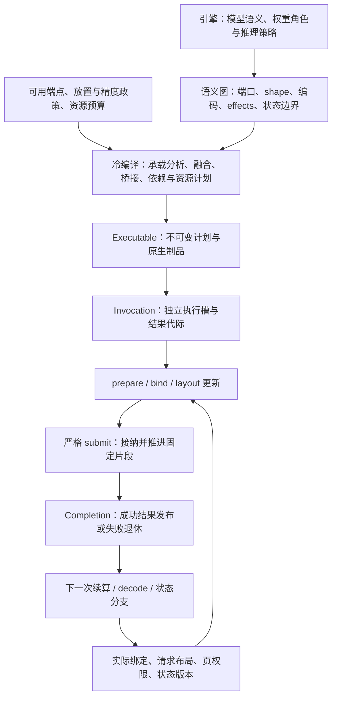

# Compute：计算语义、实现选择与资源边界

Compute 为 Direct 调用和 Graph 编译提供共同计算合同，保留 CPU、CUDA、Apple 与 Vulkan 的原生执行方式。
它不依赖 Graph，也不解释模型文件、生成策略或 serving；这些职责由项目内的引擎层承担。
Compute／Graph 可脱离引擎独立使用。用法与限制见[用户 Compute 指南](../user/compute.md)。

## 语义与执行分开

公共语义描述 operation、全部端口的 dtype/encoding/shape/layout、alias、状态、副作用和资源要求。
Provider 把这个合同绑定成原生调用、完整 region 或原生扩展。设备能分配内存不表示某个 Provider
能计算任意格式；库名称也不能代替实际算子能力。

Direct 用户无需取得图编译器。Graph 在相同语义上组合片段、决定跨片段边界和资源计划，
Provider 继续拥有片段内部的融合、packing 和执行。避免把成熟 region 拆成逐 kernel 的虚调用链，
也避免为统一外观复制一套线程池、队列或 allocator。

## Provider 与资源所有权

接入有三种形状：直接调用原生 primitive；将 op/region 编译为 Provider 自有程序；
在 Provider 明确支持的扩展点内加入原生 kernel。三者可以共存，选择依据是完整计算的成本和能力。

Provider 自有 allocator、tensor、stream、workspace 或 capture 时，HYLE 保留这个执行岛：
边界完成合法 import 或显式 copy/repack，内部使用原生程序，输出由真实 owner 保活。
结果不必复制进 HYLE 影子 buffer；也不能修改第三方内部字段或伪造 buffer 来宣称零复制。

caller-owned storage 只通过实际支持的 typed interop 接入，核对 device、范围、编码、coherence、
borrow/ownership 和完成边界。CPU external pointer 可用，不能推出 CUDA、MLX 或 Vulkan 同样可用；
同一 GPU 上的不同 runtime 也不会自动共享 allocator 或 stream。

对 ggml，合法适配保有 tensor metadata、backend、常量和 invocation state，用原生 graph compute
执行已准备的单 op 或完整 region。其内部仍可能编码、分配或同步，应报告真实成本。
旧桥接中“简单节点成功而 varied-shape 图因伪造 buffer 崩溃”的教训是保留公开 import/allocate 边界，
而不是恢复旧 adapter 或把私有 kernel 函数当稳定接口。

## 冷路由

普通用户只选择可用设备和实际请求，不排列 Provider、不填写 timing profile。
实现规则由库维护，在 Context 创建和 prepare/compile 时匹配；submit 只调用已经绑定的制品。

匹配依赖三类只读事实：

| 事实 | 归属与作用 |
|---|---|
| `RouteEnvironment` | Context 捕获的 OS/ABI、设备、ISA/SM、features/limits、driver/runtime/SDK 与 Provider 身份 |
| workload / `ModelArtifactProfile` | 引擎已核对的模型/制品 revision、配置/manifest digest、phase 和 region 意图；不包含权重或 parser |
| `RouteSubject` | 本次 operation 全部端口，或真实 Graph region、canonical boundary、state/effects 与资源约束 |

模型画像可为空，普通调用仍能使用合法的通用基线。画像、字符串和 digest 由冷 owner 保活，
不借用调用栈；模型名或文件名不能代替真实端口检查。未知事实与明确的零值不同，
规则要求的事实缺失时不命中。region 意图不能替代 Provider 对真实 DAG 的检查。

选择先排除未交付或不满足语义、资源与设备条件的实现，再应用固定规则；Graph 还考虑完整计划的
覆盖、融合、搬运、等待和 workspace。稳定 Provider/implementation identity 用于诊断和缓存，
注册顺序、数组顺序和“规则更具体”均不代表更快。同优先级的冲突须明确处理，不能随机挑选。

只在接纳前、无副作用的能力或预算拒绝时，才可尝试预先声明的合法后备。创建制品或接纳工作后的
真实错误不吞掉、不换设备重算。匹配不到性能规则可使用合法成熟基线，不能把它称为测量赢家。

## 制品与执行状态

不可变代码、权重和 packing 可以共享；bindings、scratch、descriptor/command pool、可变库状态
及输出按原生并发要求独占或池化。同一槽未到真实终态，不得重绑、覆盖输出或回收其资源。
共同Operation/Graph invocation接纳后若失败，终态意味着该槽退休，需要重建槽；
不是错误一返回就可重试。接纳前拒绝可按合同修正输入再试，重建槽也不能修复device loss。

数值/物理格式、shape domain、所读环境事实、Provider/policy版本或相关常量身份改变后需要重新准备。
普通 payload、token值和域内实际尺寸仍是输入。跨制品 cache由消费者明确拥有，不使用裸地址、
仅模型名或进程全局隐式 cache 代替完整 identity，也不承诺跨编译器持久化。

普通prepared成功准备后的replay不再做shape推导、heap分配、JIT、tactic搜索或packing。
managed可承担已声明的metadata/array及cache/shape工作，不因此允许JIT/search/repack或隐藏copy/sync。
需要native planning的批次走独立layout准备，见下文。prepared/managed、capture与是否阻塞是不同轴，
不能以同一个“graph replay”名称掩盖不同成本。

## 存储、同步与生命周期

Mem 提供 allocation、mapping、view、quota 和寿命原语；Compute 解释 native resource及异步使用；
Graph 提供依赖和 liveness/alias事实。host metadata、payload、第三方 heap和driver内存各自计账，
未知私有内存不能记成零。释放使用原 owner、size和alignment。

Graph先建立必须共享的View/alias，再按底层存储组汇总所有读者寿命。可选原地写必须等该组最后读取，
并证明其他lane的读者happens-before本次写；早于它的节点序号不足以证明设备工作已经完成。
已发布View按完成后仍有读者处理。证明与依赖分析在冷编译完成，重放使用已选计划。
原生View的存储父节点与权限owner分别保留：Vulkan使用别名shared_ptr让指针指向真实Buffer父节点，
控制块继续持有lease、页帧或权重选择；不能把不透明owner当Buffer追根。
[四入口回归](../evidence/correctness/vulkan-view-root-owner-2026-10-20.json)同时检查资源报告与原权限寿命。

CPU happens-before、CUDA event、Metal hazard/fence/event和Vulkan execution/memory dependency
保留各自语义。unified/shared内存不消除同步；必要的 host wait应显式报告。
只用于 host编码的临时数据可以按合同提前释放，设备仍引用的数据、参数和代码必须活到真实终态。

部分接纳后保留已提交前缀；事件记录失败不表示没有接纳GPU工作。取消停止后续工作，不等于抢占
既有kernel。停止接纳与显式drain分开，具体close是否等待服从该owner的API；共同Context的close只停止接纳。
未知完成状态不得变成可回收状态，
不能靠析构隐藏无界等待。资源权限和流送还需要下述约束。


## 资源权限与有界流送

只读租约可共享，独占写权限要求相应范围没有读者或在途使用。alias按物理范围而非wrapper地址判断；
成功写入后才发布ready只读内容。Direct/Graph绑定同时保有payload、索引/参数metadata、producer与native owner，
直到真实最后使用。引用归零与GPU退休是两个条件，不满足任一条件都不能回池。

共同Graph在冷编译末尾按实际MemoryResource身份和allocation handle，为不可变常量与prepared范围建立排序索引。
输出bind只查询相同allocation的成员，再执行原偏移、长度与planned-alias检查；不把opaque handle解释成CPU地址。
冷构建为O(R log R)，查询为O(log R+K)，K为同allocation成员数，共享整块bank时仍可能检查全部成员。
索引只是原Plan的metadata，不另持payload或权限；动态输入、输出、effects、owner、reset及退休检查不由该索引缓存。

动态输入/输出的候选索引归Invocation，以相同resource与opaque handle分组，创建时一次分配容量。
成功bind才更新该物理实例的全部逻辑成员；失败保留原绑定，内部生成/View投影改变范围后只重建一次。
组内保持原输入/输出检查顺序，仍执行原重叠与权限判断；共享整块bank或hash碰撞时仍可能遍历较多成员。
该metadata由原预算allocator计费，不增加逐bind分配，也不缓存就绪或访问许可。

Invocation的资源episode在准备时建立ValueId到固定binding槽的索引，查询仍核对完整身份与generation。
只有匿名投影页权限追加在尾部；重绑仅扫描真实额外页，不反复遍历固定binding表。
reset撤销本轮租约、页权限与就绪；原生录制按实际资源依赖决定保留或失效。索引只定位记录，不缓存权限或旧结果。

一个重要反例是“事件记录失败”：前面的kernel可能已经接纳，错误返回不能触发正常释放。
资源必须留在仍能推进退休的owner中；若完成状态未知，不能凭Status非OK判断它已经结束。
这种保活也不能形成失败suffix永远持有producer的引用环。

普通消费者可在已保活owner中嵌入稳定的`CompletionRetention`节点，将一份已持有的引用附到原Completion。
成功才转交引用，失败不消费；原runtime在实际退休时调用release，inline完成可在attach中同步释放。
节点不可移动或提前析构，取消、观察失败及放弃句柄都不代表退休。该接口复用原附件链，不额外分配或执行工作。
直接附加须在异步首次观察前完成，或已有独立的真实退休证明；缓存的观察错误不能充当这种证明。
`CopyBatchUpdate`公开源数量与按索引附加，每源一份节点／引用，原生实现封装Completion和观察锁。
源范围是已接受phase引用的producer绑定及phase，producer去重；部分phase失败时可能保守包含尚未尝试的producer wait。
观察后仍有phase未退休时可拒绝迟到附加，失败不消费引用，不能把丢失的原生观察句柄当inline退休。

批量byte copy冷准备固定域、范围/groups/slots与bytes上限。独立copy可重复读取source，
不能隐含destination重叠或批内依赖；有依赖时用明确阶段。全批预检后仍可能部分接纳，
需保留实际prefix与所有可能被引用的控制数据。copy保持物理bytes，不替代编码转换。

文件流送由显式服务产品 `compute_stream` 提供；默认 Compute/Graph 的头文件与链接闭包不带 IO。
四个按所选路线装配的薄桥接复用原 CPU/CUDA CopyBatchProgram 与 Apple/Vulkan 原生 copy program，
不选择数学 Provider、不另建 Queue 或执行器。消费者显式包含对应的 `*_file_stream.h`，
CPU/CUDA 的纯搬运 Context 可不配置数学 Provider。服务只处理已有 File/Mapping 与 resource 范围：

```text
文件 → 有界staging → native copy → group ready → 计算使用 → 回收
producer完成 → read lease → D2H/共享可见 → positional write → 完成
```

旧ready/use leases继续占slots和预算，容量满产生背压，不自动淘汰用户内容。
已成功组可消费，后面失败不把整批写成成功。direct IO、short progress及不能被逐操作抢占的文件fallback
沿原IO合同；取消不等于中断pread/pwrite。格式解析、文件命名、原子发布政策与模型cache属于引擎/IO。
回收先释放已退休写回请求对读输出的内部引用，再检查读请求，两次线性扫描后即可复用已归还的范围；
外部租约与未知 native 退休仍保持原门。GPU producer 的就绪与错误须观察原 Completion，不能将缺少终态提示当作成功。

## 集合发布不是多设备事务

状态schema声明有限opaque成员和资源约束；只读版本共享owner而不复制payload。
draft分享未改成员，显式clone将修改的成员，或替换为成功的out-of-place输出。不能修改base，
也不能把外部仍可写的native alias称为immutable。

```text
base → draft共享/显式clone → 新输出全部ready → expected-base检查 → 发布新只读版本
 └──────────────── 旧读者与native uses继续保活 ─────────────────┘
```

发布仅改变集合可见性，不回滚已发生的外部device写，也不表示文件已持久化。
冲突不改变current，不能按branch完成顺序自动选赢家；token绑定store、schema与generation避免ABA。
旧版本、draft、目录和copy槽有容量上限，clone按dirty bytes计费，不隐式复制整模型。
停止新更新/发布后，按本store合同显式退休自己的工作，不关闭用户Context。

这可承载推理分支，但checkpoint语义、接受前缀、RNG/token和模型策略归引擎。
recurrent算子有initial/final输出，不自动证明任意中间前缀可恢复。

## 分页计算为何需要独立准备尺度

Paged/ragged attention保持typed数学schema，不将单storage Tensor改成含混分页对象。
paged描述arena、page IDs、indptr、tail与真实active counts，ragged描述packed segments；
metadata、device mirror、plan与payload必须有相符generation和owner。
接纳前校验单调、边界、dtype/layout、overflow/GQA、空序列及causal相对位置，padding不能作为真实KV。

| 时机 | 工作与边界 |
|---|---|
| program准备 | 固定算法域、dtype/head/layout、capacity、workspace和slots，绑定实现 |
| layout准备 | 复制/验证host快照、native planning、metadata上传及必要host等待，产生本slot/generation的token |
| native提交 | 执行已准备批次，不再读取可变caller span、搜索Provider或隐藏新planning |

原生planner可能分配临时vectors或查询occupancy，这些是layout准备成本，不是无规划replay。
多个并发槽各有mutable plan/workspace；布局或失败退休改变后旧token失效。
只改page IDs能否复用计划取决于原生算法，不能按地址/尺寸猜测；固定batch和稳定地址也不足以保证capture。

Graph协调同slot的region与prepared token，不能在外部规划A后提交B。
只读attention不制造effect，KV append/scatter等真实写入才需要writer与顺序。
把paged数据gather为连续临时再执行dense数学可以是明确参考路线，但必须计copy/capacity/workspace，
不能把它当原生paged kernel。各后端的dtype/head域与capture能力仍按实际实现说明。

### 多会话缓存与共享前缀

引擎共享只读权重和编译计划，按会话／请求保存可变状态，再用独立Invocation槽及显式layout组织执行。
模型接入声明自己的状态成员、位置和提交／恢复语义；相同状态类型共用机制，目录、预算、COW与退休不按模型或后端重写。
`query_indptr`／`kv_indptr`和页表描述批内各请求的查询与历史；`PagedArena`提供独立页面权限，
`StateVersion`／`StateHead`发布同代状态。会话目录、准入、页选择／淘汰、前缀索引和连续batch调度由引擎组织。
批内request索引和资源generation不承担用户／会话身份；同一用户的多个对话也分别维护状态。

前缀复用须匹配模型／adapter、实际token与位置及缓存数学格式等语义。共享已提交前缀保持只读，分支缺少尾权时显式复制或分配新页；
原读者和native uses仍占页面与预算，取消或驱逐目录项后仍须等待实际退休。
Radix等前缀索引属于引擎策略，复用相同的底座状态／页机制。最长公共token前缀不自动具有可恢复状态：
混合recurrent模型的命中必须落在已有完整状态检查点；不能从任意KV页切片推导对应conv／GDN状态。
Qwen3.5等混合模型要把KV、conv历史、GDN recurrent状态及有效位置成套维护；只复用KV不足以恢复完整会话。
引擎的一个完整快照同时拥有定长状态（`StateVersion`或实际结果读租约）、所有KV页帧及位置；收齐成功结果后一次替换会话head。
定长状态和页帧分别发布不能作为整会话提交。原算子已有old→new输出时直接保留新结果，无需先复制整份旧状态。
共享arena的实际backing只计一次；旧快照、前缀检查点和在途写入仍占真实页／状态容量，不能继续按每会话整份dense缓存估算。
Qwen测试消费者将权重／有限编译图族、KV arena和状态池放在Model，各会话保留不可变完整Snapshot；Invocation／IO／workspace按实际执行并发由Model有界借用，不按驻留会话复制。
分页路径在一个批次episode内收齐每个参与者的12份KV帧与36份conv/GDN结果、撤回已退休状态绑定，并验证全部expected base后提交各head。Model持有参与Session直至真实退休，Session仅借用pending链接；整批取消保留所有旧head。N份已提交版本和R份同时候选分开计费，前端仍负责发布后N份版本的准入／淘汰。单会话与四会话交错淘汰重建已逐字节对照；真实B2／T1另核分流、旧帧和继续推理，不以跨B输出逐字节相同为默认承诺。
完整状态隔离与提交、精确前缀／分支及真实CUDA在途回收已由Qwen消费者分别验证；多用户服务吞吐与其它原生后端仍须另验。
`PagedArena::reframe`按目标layout从同arena的ready帧组合或投影精确页权限。attention／MLA与row-cache保留各自强类型，
共同限于来源的逻辑有效行及原guard范围；只保目标页，不以当前frontier扩大旧权限，不导出裸bank或由pending制造ready。
它不负责会话身份、recurrent检查点或调度，批次成功后完整状态的分流与提交仍由引擎完成。
普通Graph现可用`graph::batch::PagedAppend`表达精确写页的外部副作用，`PagedAppendPages`接入旧ready帧、
新layout和原脏页writer；`bind_append`把这些精确权限纳入原Invocation，后继reader须有明确Graph依赖。
`take_append`只在真实工作退休后取回原事务，只有whole Graph成功才允许其`ready()`发布新帧。
当前写页已接共享Queue的CPU/CUDA普通F16/BF16和Apple/Vulkan固定形状原生行复制，继续保留各自实际执行与退休机制。
原生本批覆盖F16/page16/D64的writer-only与同图因果reader；完整消费者、其它dtype／形状另计，encoded页尚未接入。
fresh/COW路径分配新脏页并复制有效旧前缀；独占续写则只写同页尚未提交的后缀。旧快照及在途uses继续占页和预算。
`Invocation::unbind`可在真实退休且旧结果已释放后成批撤回指定caller端口；先验证全部端口及受影响原生载体，再撤销准备并释放其实际导入owner，其他caller端口保留。原生能力沿既有扩展查询声明，不在共同层按Provider点名。只借用TensorView、确无导入owner的载体可保留不可运行的物理录制；下一次仍核全部权限和实际后端的稳定身份，不以地址相等授权。缺少能力或输出仍逃逸时明确拒绝，不用旧租约维持录制。

独占续写使用move-only的`PagedPageAppender`，独立于后端是否可录制。
fresh writer的`publish_appendable`只暴露已提交前缀的有界读租约，并交出唯一尾权；尾权只能预留其后连续的新行。
旧只读快照不会复制尾权，分支缺少尾权时沿原COW路径。接入Graph时传入原尾权，`ready()`发布新的有界读者，旧读者的范围不变。
普通whole-page ReadLease／WriteLease合同不变，也不从引用计数或subview推断写资格。append epoch独立记录失败与实际native uses；
失败不扩大已提交前缀的故障范围，whole Graph成功且真正退休后才推进frontier，否则退休后rollback。同页原生访问暂串行化；
原Graph按root只准入一次后缀写和经过验证的旧前缀读，不能用普通整页writer混用来绕过冲突。
Qwen消费者独占续写及有界Radix目录的[实际结果](../evidence/performance/qwen-exclusive-radix-2026-10-21.json)分别核尾权和完整状态命中。
Radix结构分叉不产生conv/GDN检查点；现索引只命中已发布的完整快照。索引与LRU预留有界存储，旧快照的逃逸引用仍受原页／版本预算约束。

可录制写页已由Compute batch的typed append program与CUDA后端扩展实现。原生参数固定bank、packed输入与descriptor地址，
冷阶段更新page ID、旧尾部和新行范围；同一Invocation、Queue、layout及完整实际映射才共享descriptor，页权限仍逐bank独立。
descriptor上传使用原Queue的真实读／写租约与Completion，退休后发布；Graph每次执行又独立接纳其读权限。该存储归IO／workspace预算，
不混入引擎的状态缓存字节。bank backing可保活，但不能以它代替旧页读权或新页写权。
Graph按实际writer／reader制品、原DAG、完整参数身份及所选capture后端决定是否保录制。撤回页权限先撤销执行准备；
保留的命令只有更新metadata、接纳本轮权限并重新seal后才能执行。更换bank／descriptor载体须先失效旧录制，packed输入与脏页重叠会被拒绝。
无该扩展时继续原普通Graph写页，不新增执行器或消费者原生专线，也不在共同层点名Provider。
[可录制写页结果](../evidence/performance/qwen-capturable-append-2026-10-21.json)覆盖fresh／COW；本批另接独占尾权，encoded写页与其它原生后端仍未完成。

### 生成记录与缓存重算

完整缓存表示已经消费的输入前缀；Graph算出的下一步预测，以及引擎已经返回但尚未写入KV的token，是另外两种事实。
后者由引擎保存，不能因缓存淘汰后重新计算的greedy预测不同便改写。采样本来也可以选择不同于argmax的token；
计算层处理给定输入，生成策略核对本次实际输入与已发布token的关系，不把缓存中的greedy结果当作唯一合法输入。

正常缓存重建沿已提交的真实输入块重新计算完整状态，不重新采样历史，也不将旧输出数组直接作为已消费输入。
例如MTP接受两行时，实际消费的是pending与当时接受的draft；bonus仍是未消费输出，拒绝行也不属于历史。
重建可将草拟缓存补齐到同一目标前缀，额外计算须计费；旧输出与自然接受记录保持不变，新预测及数值差异单列。
使用目标hidden作为输入的MTP还须区分目标tap与递归草稿hidden，以及它们对应的token位置。
接受草稿后，仅替换hidden不能修正已用草稿hidden计算的KV；消费者须用实际目标tap和已消费token补算，
或在完整状态中显式保留待补齐的frontier、token及目标hidden，并在下次消费前完成补齐。
补算复用原Graph；所选目标状态、已完成草拟状态及必要待补算信息由一个完整版本承载。
状态层不判断模型公式，也不隐式修缓存。
批宽、分块或合法归约变化不承诺逐字节重建；严格复现原执行形状属于另行标明的数值诊断合同。
重建仍走原Graph、页权限、完整状态提交与实际退休机制，全部成功后才公开新head；不为恢复另建执行器或保留隐式GPU旧状态。
Qwen真实批次、已提交输入重建与pending政策的有限实跑见[本批证据](../evidence/correctness/qwen-mtp-batch-2026-10-22.json)；跨批宽质量和其它原生后端未完成。

## 推理执行体系的重构形状

2026-10-18 的接线审查暴露了三处结构问题：同一 backend 的承载判定分散在 Direct、Graph lowering
和冷占位路径；共同 Graph 直接识别具体 row-cache 算子和 ProviderId；Apple/Vulkan/混合路线重复维护
计划、值与执行槽。共同 prepared 输出合同又只接受 caller buffer，不能直接承载真实的 MLX/Vulkan
生成结果。单独补白名单无法解决整条推理链的衔接和性能问题。

本节记录本次全量重构的目标与当前共同合同，**不代表全部模型功能已完成**。以现有 PreparedOperation、Executable、Invocation、
Completion、ResultLease、资源租约、StateStore 和 SubmissionCursor 为基础迁移；统一它们之间的合同，
保留成熟原生程序与执行岛，不另建一套执行器。

共同 Queue 路线的资源租约、只读结果和完成观察现已收进原 `InvocationState`，不再由
`LeasedInvocation` 持有第二个槽。typed batch/page 只附着布局、frame 与 source controls，
使用同一提交游标和实际退休；被替代的 batch provider/coordinator 公共入口直接删除。
CPU、CUDA、Apple、Vulkan的普通执行、生成结果与混合消费者现已使用原槽；重复混合运行时已删除。
可选文件服务已独立装配；原生成本与其余模型功能仍须继续收敛，不能由入口统一推导功能或性能完成。

### 完整调用链与职责



| 职责 | 唯一归属与复用边界 |
|---|---|
| 模型与语义 | 引擎生成数学图，知道 attention/GDN/MoE 等模型语义；schema 描述端口、encoding、shape、alias 和 effects，不选择 Provider |
| 原生承载 | 同一 backend 的 carrier 分析、准备与绑定事实供 Direct 和 Graph 共用；Graph 另外判断拓扑覆盖、融合与副作用，不能把单 op 支持当成任意 region 支持 |
| 不可变计划 | 一份逻辑值到物理表示的映射、粗粒度片段、显式桥接、依赖、生命周期和预算；CPU/GPU/混合不再各复制一份中间 DAG |
| 独立执行槽 | Invocation 持有本槽 bindings、native plan、workspace、metadata、结果槽和在途完成状态；不可变权重与制品共享，可变资源遵守原生并发要求 |
| 页与状态组合 | batch/state 模块证明逻辑 schema、版本、footprint 与发布条件；共同 Graph 检查限定端口、物理依赖、alias、权限和寿命 |
| 后端适配 | 保留真实 Queue/Program、原生值 owner、依赖导入及进度机制；按粗粒度片段调用，不新增逐 kernel 重型分派 |

普通引擎的执行中间层只处理图入口、绑定、状态、结果与完成，不判断 CUDA/Metal/Vulkan 算子或 ProviderId。
设备放置、精度与预算仍是引擎政策；平台初始化集中在端点装配。Direct 继续可以独立于 Graph 使用，
原生 SDK 的能力由后端适配代码承载，不要求普通消费者学习全部原生 API 或内部 CMake 宏；
不能以 expert 入口为由保留已被替换的 Hyle 公共接口。

### 根据实际调用链收敛

设计按已经接通的承载与故障路径修正。维护性首先看每个事实有几个写入者、一次改动要动哪些层，
不能只看公共类是否统一。以下边界约束后续迁移：

| 事实 | 唯一负责处 | 不应随之增长的机制 |
|---|---|---|
| 实现支持域、原生输入输出与阻塞成本 | 被选中的 prepared 制品；Copy 使用真实 TransferMode | Graph 中的算子／Provider／平台名单 |
| 依赖与可录入工作 | 原 Plan 的边及索引，原 Cursor 的 claim／commit | 各 CPU＋GPU 组合的第二份 DAG、前沿和执行槽 |
| 接纳后保活与槽终态 | 原提交寿命管理，合并原有 driver sentinel 与 native guards | progress 自己的退休计数、结果槽或 Phase |
| 何处执行、何时唤醒 | 可选调度装配及原生运行时 | Compute 对 Scheduler 的依赖、Graph 自建线程池或 Fiber 生命周期 |

提交寿命管理由现有 ResourceEpisode 的退休部分提取，不复制一套计数；租约、权限与 typed payload
仍归资源附件。无租约的异步图不创建假的租约状态。Completion 的多终点聚合只合并观察结果，
不能与真实退休争夺槽终态。对象引用、旧结果占用和旧 Completion 占用分别解决不同问题，不能合成一个 done 位。

现有同步资源路径已完成这项提取：原槽的可选 `SubmissionLifetimeOwner` 持有原退休节点、首错、
admission sentinel 与稳定的 ordered admission，ResourceEpisode 不再持有退休计数。无资源的普通路径
不创建该附件；显式冷准备共同寿命也不创建租约池。资源路径多一个冷 owner 分配，热推进仍复用固定节点。

| 本轮执行情况 | 允许发生的状态变化 |
|---|---|
| 仍有 driver／工作回调可能访问本槽，或原生前缀尚未退休 | 保持在途；即使已经返回错误，也不能重绑或覆盖 |
| 无原生工作被接纳，所有本轮槽访问已结束 | 回空闲；修正输入或投递条件后可重试 |
| 原生工作已接纳，全部真实退休 | 成功发布输出；失败则退休该槽，不能直接重试 |
| close | 只停止新接纳；cancel 请求停止后继，drain 等待实际退休，各自不替代另两个操作 |

任何新增通用机制先对应一条实际调用链，并说明替代的旧实现。普通算子、融合和量化接线不应修改上述
调度与寿命核心；新的资源或同步语义可以扩展真实合同。迁移允许未完成项，不能将临时实现成本写成最终保证。

共同抽象以实际推理计算为依据：先核对 prefill、续算和 decode 的真实数据范围、计算、状态反馈及
资源寿命，再提取已经一致的部分。名字相似或调用顺序相似不足以证明可以共用；活动行数与容量、
ready 权重与可写 KV 更新、设备排序与 host 观察等差异须保留真实语义。公共流程不能迫使模型多算
容量行、补齐复制或提前等待。尚无真实消费者支持的共同点先留在具体实现，用模型旅程发现的成本和
接缝修正边界，不为可能的组合预建通用框架。

### 一个请求到底怎样推理

以 KV 容量固定为 32 的文本请求为例：首次输入 23 个 token，随后续算 4 个 token，再逐 token decode。
这是已有图、布局、状态与执行槽的组合流程，不另提供模型引擎 API；各数学域仍按实际承载核对。

| 步骤 | 引擎提供的语义与数据 | Hyle 完成的工作 |
|---|---|---|
| 模型准备 | 解析权重、配置和 tokenizer；描述各层数学及权重角色 | 接纳真实常量和资源 owner；可复用的代码、权重表示和 packing 由明确 owner 共享，避免各 phase 重复持有同一制品 |
| 构图 | 用数学节点表达 embedding、attention、conv/GDN、FFN 等；声明 KV/state 输入、输出和布局语义 | 校验数学、端口和状态依赖；模型有意义的 reshape/permute 保留语义，物理转置/Cast 由实际承载和桥接计划决定 |
| 冷编译 | 可用端点，精度、放置和预算政策；prefill/续算/decode 的 shape 域或有限入口 | 发现实际实现，选择融合片段，确定显式转换/搬运、依赖、常量和资源复用，得到不可变 Executable；每个入口不另造执行体系 |
| 请求准备 | 本请求的 token、绝对位置、KV/state 版本，以及本次不可变 batch/page layout | 选已准备入口，绑定独立 Invocation；更新必要 native plan、metadata/权限与准备版本。布局准备成功后才允许本次提交 |
| prefill | 23 个 token，位置 0…22，旧状态为空，实际 KV 长度 23 | 按固定计划执行整条图，写入新 KV，产生 conv/GDN 新状态与 logits；设备结果保持原生 owner，依赖按实际端点推进 |
| 续算 | 4 个新 token，位置 23…26，直接绑定上轮真实状态与 KV，有效长度 27 | 复用代码与驻留权重，只处理新 token、写新增 KV 行，反馈下一版状态；不重新展开前 23 个 token |
| decode | 一个新 token，位置 27，有效长度 28 | 选择已准备的 T=1 入口，之后每轮复用它；更新输入与实际需要变化的布局，不随历史长度增长重新搜索 Provider |
| 完成与反馈 | 读取 logits、选择下一 token 或结束请求；token/采样政策仍归引擎 | 成功后按状态版本合同发布结果；旧读者、在途资源和失败前已接纳工作保活到真实退休，空闲槽才能重绑/复用 |

KV 的容量与有效长度分别表达。KV backing 可以保留容量 32，Q 则应接本次实际 `T` 行的投影结果，
owned layout 给出 `q_indptr={0,T}`、`kv_indptr={0,L}`；原生 causal 语义使用实际 `L` 而不是容量 32。
23→4→1 三次调用分别使用 `(T,L)=(23,23)、(4,27)、(1,28)`，因此每个 query 的可见范围正确接续。
分页场景同样使用真实 page IDs、generation 与权限。布局可以共享未变的 native planning，但更新本身须显式接纳。

实际消费者曾暴露 native page 强制容量 Q 的缺口：18 行容量、2 行 decode 时，attention 只读活动行，
上游 CPU Abs/Cast 与 Q 上传却处理了 18 行。现由 recipe 的 `input_description(layout, port)` 纯查询
按 owned layout 推导实际 Q，Direct、Graph 与后端冷计划共用；KV 与页表仍保容量，旧的无 layout 描述入口
已删除。真实 ready/pending 各 64 轮及零行路径通过原数值预算；D256/F16/H8 的 Q2 每条搬运边为
8,192B，而容量 Q18 为 73,728B。
必要的 host→staging→device 两跳分别计费，不把字节减少推断为吞吐倍数；按实际 T 构图的 CUDA Qwen
ragged 路径未据此更改。

这类有效长度是引擎已知的语义，应作为 typed layout 进入同一图/槽。编译器不从任意 F32 mask 的内容猜测它，
也不强迫引擎为每层再手动装配 batch Provider 或另一套协调器。一般 additive/Boolean mask 仍按其自身数学合同
检查真实承载；长度语义不等于支持任意 mask，不能用typed路径代签未接通的普通mask算子。

整个过程保持“一份准备好的计划＋每请求独立可变槽”：不同请求共享不可变权重/代码，KV、conv/GDN state、
workspace 与 native plan 按请求/槽隔离。纯 CPU、单 GPU、CPU＋GPU 采用相同生命周期；混合计划的设备边界及
必要搬运在冷阶段确定，单 GPU 图不强制搭建 CPU 数学路线。原生句柄尚未可用时由既有依赖前沿继续推进，
引擎不插入逐层平台判断、逐算子 host wait 或隐式全历史重算。

原生量化 MatMul 的资格与临时存储也由实际后端冷查询：CUDA 对 K 为512倍数、canonical 二维权重及
F32 激活／输出的路线复用原生 MMVQ／MMQ 选择器，将 MMQ 激活量化与 stream-K 修正缓冲计入调用方 workspace。
不可变计划只保存节点签名和实际 stream 映射；
每个 Invocation 按各 stream 的最大单节点需求预留，依靠同 stream 顺序复用，不逐节点累加或提交时扩容。
绑定前拒绝已用 workspace 与常量、输入、输出的实际字节区间重叠；Completion 覆盖原生读写退休，
直接调用者仍须保留自己提供的 backing。设备资格、预算和寿命不进入模型接线。

### 路由来自能力分析，选择结果冷生成

支持能力由语义和实现自然产生，额外的模型、算子、Provider 接入白名单应移除。选定模型集合用于发现实际负载
和核对覆盖，不是运行时准入条件。路由采用下列分工，复用现有 propose/prepare，而不另建注册语言：

公共 schema 的尺寸限制应来自数学或明确的格式合同；某个模型的头数、当前 kernel 的 tile 和设备上限归实际承载分析。
模型相关的完整数学片段可以作为明确语义存在，但不能把已有模型参数集合当成通用数学的合法域。
`RecurrentGatedDeltaNet` 已将 Q/K/V、batch、头数、状态和快照推导委托普通 GDN，
只保留自身 scalar raw gates 与共享逐头参数的合同。CUDA 的实际 D 集合与 batch grid 上限在后端共用承载分析中核对，
同时覆盖普通 GDN；数学域扩大不自动扩大任何后端的执行资格。

| 层 | 表达的事实 |
|---|---|
| 算子 schema | 计算什么、全部端口与编码、shape 域、alias/effects；不自称某设备最快，也不选择 Provider |
| 后端承载分析 | 根据真实输入和环境提出单 op 或融合 region，声明支持域、输入/输出表示、资源、同步与原生准备要求；与实际 lowering/prepare 共用实现事实 |
| 冷编译器 | 在满足精度、放置、权限和预算的候选中，组合整图的覆盖、桥接、依赖与生命周期，决定最终制品 |
| 性能偏好 | 少量有实测或明确算法依据的偏好数据，只调整合法候选顺序；不授予能力、不绕过端口检查，也不因未知模型而拒绝通用实现 |
| 已编译计划 | 持有固定片段入口、端口表和依赖；执行槽按计划调用，不在每次 submit 查询支持表 |

实现内部用于找到实际 handler 的分派可保留；不再于 Graph/Context/资源核心复制另一张支持名单。
Direct 是同一承载分析的单节点消费者。Graph先发现一次叶提案，再将当前target、实际Provider实例槽的
借用偏好事实交给region发现；best只是已发现且接纳的叶提案的最低声明排名，不保证prepare、预算或实际速度。
未知及region-only能力不伪造排名；metadata View没有数学Provider排名，仍须核对其实际支持与节点许可。
准备成功之后的资源访问事实绑定 exact prepared 与实例，不由模型名或数学算子名称推导。

实际融合沿这份候选协议补全，不增加第二份图或执行器。模型层描述数学、精度与状态，后端在冷阶段
识别其能真正 lower 的有限子图模式；完整 FFN、归一化或旋转片段可以与单算子候选共同参与覆盖。
片段能力由整体 lowering 证明，不要求内部每个算子都有同一后端的独立入口；确有新数学语义时才扩充 schema。
可见 Cast、外部读者、发布输出及状态 effects 必须映射到真实边界；内部值可以消除存储，但不能丢失数值合同。
同一原生调用支持哪些 dtype/stride/精度域，由实际 lowering 说明，不能借扩大 region 名义放宽稳定尾部或非有限数行为。
输入存储、乘法来源精度与累加精度分别翻译：要求F32累加不意味着把原本BF16的整份权重扩成F32。
原生实现能以原输入精度保证F32累加时保留该表示；否则如实声明转换成本或回退，不能仅凭精度枚举名称选择路径。
输出为F32、或原生接口声明F32compute，也不能独自证明与普通F32 MatMul等价；FP8乘法和中间累加仍须核实际数值合同。
已有[原生FP8反例](../evidence/correctness/cuda-fp8-codedot-feasibility-2026-10-20.json)：执行与capture成功仍违反原F32点积误差界，
因此不能把显式FP8→F32转换后的MatMul直接替换为该原生FP8路径。不同的量化算术应由明确语义承载。
channel/token FP8也先核实际量化规则：固定CT参考的BF16逐元素QDQ与部署端FP8点积不是同一计算。
前者已用普通Reduce、Cast、Select、Binary和MatMul串成CPU/CUDA消费者；仅补通用Bool Cast，未增加模型专属算子。
随后CUDA Cast已统一到既有原生PreparedOperation/shared queue，删除旧managed转换分支，完整QDQ链可RequireCapture；
浮点类型与64位Cast寻址限制在tensor私有边界，普通算术的原寻址域与共享ElementType不扩张。
连续存储省去坐标除模，真实byte strides仍走同一程序的索引分支；BF16 NaN位规则与CPU SIMD一致。
零scale替换、BF16反量化舍入及最终结果寿命见[实际回归](../evidence/correctness/fp8-channel-token-qdq-2026-10-20.json)，
原生转换、数值一致性及capture见[后续回归](../evidence/correctness/cuda-native-storage-cast-2026-10-20.json)，
部署端候选的scale、累加及平台边界见[固定来源研究](../evidence/research/fp8-channel-token-contract-2026-10-20.json)。
这不证明整制品支持，也不授权将QDQ替换成另一种FP8计算。

存储 scale 的静态 FP8 另保留明确的普通图：`F32(A)*F32(1/SA)` 经 SATFINITE E4M3 RNE 后扩宽做
F32 code-dot，再分别乘 `SA`、`SW`，最后转输出类型；不预合 scale 或先窄化 BF16 操作数。
四后端复用共同的 reader/control 闭合证明识别这条链；CPU/CUDA 按实际端口数冷准备映射，适配原 prepared
接口，Apple/Vulkan 沿原 native region lower。所选同 build 私有线性载体直接读取原权重，
没有新增公共算子、模型名单、执行器或热路由；公开中间结果仍走原图。
普通路径自身也必须正确：原生 F32 乘除的 FTZ 曾使逃逸路径丢失非零 BF16 结果，
Apple 的通用 F32 标量桥保留正常乘法、以严格位级实现处理敏感边界；CUDA 在该精确标量域
优先选择已有的严格 native 叶，并复用原 ggml 区域排序门控，静态 FP8 候选排序保持。
[定向记录](../evidence/correctness/static-fp8-reference-2026-10-20.json)保留该真实红绿；
这不承诺所有布局、原生 TensorCore FP8 等价或性能改善。

能力与偏好分开。ggml CUDA普通组合只从本实例不劣于已知最佳叶的节点发现islands；已知非优选节点
保留原leaf后备，不再补完整合法普通大岛作为另一份预算/packing后备。成员排名未知时保持未知并沿原源偏好，
不以缺少独立叶入口拒绝region-only能力。真正物理融合另提具有独立实现身份、数值和成本事实的候选，
可以跨非优选单算子；例如沿def-use连接SiLU与Mul，不要求两者在图中连续，也不改消费者插入顺序。
公开中间值和外部读者不能消失，BF16逐节点RNE可以在寄存器中兑现，不能只在整段末尾窄化。

当前排序依据声明偏好、有限成本及稳定身份，不是精确GPU总成本优化器。转换、物化/packing、同步、
workspace与首次准备/capture均须计入实际消费者成本；dispatch计数不是kernel计数。region可执行多颗kernel，
跨Provider的capture只聚合提交；节点覆盖、物理融合与录制三者不能互相证明，也不因step更少就自动优先。

融合边界优先复用 Graph 已能直接承载的 metadata View。CUDA dense BF16 index score 消费实际的
`Q[B,T,H,D]`、转置 `Kt[B,1,D,L]` 和权重 View `Wr[B,T,H,1]`，候选只覆盖点积、Relu、乘权、头归约及可选 mask／扩宽。
View 保留原有零命令路径、发布和读者；原生冷资格核对真实 KV batch pitch，按 key tile 直接读取原存储。
同一原生 Provider 复用原 Lt、typed 计算与调用者 workspace，三处 BF16 RNE 和 mask 的独立舍入仍兑现。
这是原 Region 扩展的能力装配；Context、QueueSequence、Invocation 与完成退休沿原执行链。

选定融合仍生成原 PreparedOperation/region 制品和独立 Invocation。常量、程序、workspace 与未完成工作
沿原 owner/Completion 保活；同一语义的 prefill/decode 或有限 shape 变体在冷阶段准备。
每轮 token、位置和有效长度通过既有 bind/metadata 更新；原生确需重新 planning 时明确属于冷 layout 更新，
只撤销受影响的准备与录制，其余片段继续复用。热 submit 不重新做模式匹配或拆回逐算子选路。
稳定的调用者 tensor 绑定与每轮 layout/page 派生权限应在原槽内分别更新：旧工作和读者 gate 仍先通过，
替换派生 metadata、页 owner 与实际访问证明时，不强迫无关绑定重新提交。当前 `batch::prepare` 通过
`reset_configuration` 撤销原配置 episode，保留稳定调用者绑定与 owner；受影响的派生权限仍重新准备，
旧工作、结果读者和失败门控保持。D1进一步复用同址同描述的物理spans，见[准备成本实测](../evidence/performance/qwen-prepare-bindings-2026-10-20.json)。

CPU默认Direct/Graph现共用一处真实Provider装配；同一ggml实例同时提供普通操作与region扩展。
普通操作偏好与region偏好分别保留，实际融合、关闭融合后的fallback及单操作执行均核对同一实例和原数值。

已有独立原生规划能力时，冷装配可把原 Context 的真实 capability 接入同一个 region 编译协议；
不伪造 Provider、不另建 Context，也不遮蔽原有融合候选。编译借用的适配配置不会进入热提交；
选定制品保有真实源 owner，执行槽用拥有身份的 layout 冷准备，随后走原 Queue、Completion 与结果寿命。
共享与原生源均可携带编译期适配配置；原生适配必须保留从实际 Source 查询到的 capability，
不能把适配回调表冒充来源或取得 Compute provider slot。配置影响 packing 时仍须进入原有制品 key。

执行目标改为持有 `ExecutionSource`，不再保存可移动的公开 Context 指针。Compute 源保有原 Context 的
内部引用；原生源保有实际 Runtime。源只提供身份、资源检查与接纳，不另造设备、Provider、Queue 或调度器。
共享 region 仍绑定实际 Provider 实例；原生 region 没有 Compute provider slot，不能满足要求特定 Provider 的约束。
常量 packing 同时按实际源 owner 和实现身份隔离；共享 Queue 的热提交仍直接调用已选 prepared 入口。
Vulkan与Apple生成结果、CPU混合端点、有限形状、权重及分页准备已由共同执行槽承载。
Vulkan固定backing与Apple生成Array保留各自真实owner；共同流程不强制两者采用相同复用限制。

冷发现接收 `RegionDiscoveryRequest` 的节点许可：共同层提前合并 required target、Provider 实例约束与当前
精确域资格，preferred 放置仍是偏好。后端用原承载生成合法片段，最终准备继续核数学与资源；许可不是支持证明。
普通岛的共用分段在新增外部入口前驱时结束片段，避免让早期工作继承额外等待；直接前驱检查为O(V+E)。
真实融合可沿def-use另提非连续节点集；共同边界与收缩检查继续保证data/control不离开后重入，所选step等全部入口就绪。

物理 Copy 继续是一份计划中的 Copy；原生 Source 可用相同 prepared/Invocation/Completion 合同承载它，
不伪造 Compute Queue。Vulkan 在冷绑定固定跨度并录制原 CopyRecording，热提交只复用原 Run；CPU 与 device
通过明确配置且计费的 staging 双向搬运。同槽同地址改内容可重放，改跨度须重新冷准备；未退休的原 owner 阻止复用，
已 settle 的 Completion 保存独立终态，不因仍存在而无意义地阻塞下一次执行。driver 私有开销仍按未知报告。

搬运选路还必须知道源端口何时具有实际表示，不能只看提名 MemoryResource 是否可映射。
region 的资源提议逐输出声明 caller／stable／bound／deferred 时机和是否具有真实 Mem 投影，
两者分开：已有原生句柄不一定有 TensorView，deferred 的投影承诺也不代表冷阶段已有地址。
编译制品须按实际逻辑端口与提议核对；已冷折叠的常量输出沿原 owner 校验，不能误用压缩后的端口编号。
Copy 能力同时证明它能接纳该源表示与真实目标。普通 Queue 接受一个资源，不等于它能冷绑定未来才产生的句柄。
同一 Runtime 可由原 Job 接纳实际端口引用；进入普通 CPU 时，须使用已准备的真实桥接，或由选定 CPU
制品明确承诺晚到只读端口，不能按 HostAccessible 放宽精确资源合同。输入端口逐项声明能否接原生值／原输出引用，
还须同实际 Source owner，最终绑定核真实 implementation、端口和描述；不能用 native/shared 平台分类代替这项能力。
同一 storage 中也可能需要已计费的 caller backing，不能让存储编号掩盖 carrier 差异或覆盖原 producer。
Apple 的 dense 输出已通过原 CopyRecording 的 FIFO Job 搬到固定可映射目标，重复提交按新 producer epoch pin，
完整校验成功后才写目标，退休统一放 pin；没有热绑定、额外执行槽或只读 import 写权限。
CPU＋Apple可选progress也使用原游标；实际HostWait与managed数组成本仍须报告，不能冒充零等待或零分配。

异步推进只保有一个进度 owner，驱动同一个 SubmissionCursor。原线性 advance 遇到 HostWait 即停，
会挡住后面的独立片段：例如异步 GPU 段 A、依赖 A 的 CPU 段 B、独立 GPU copy 段 C，冷排序可能为 A、B、C。
共同游标现已直接复用原 `segment_dependencies` 推进就绪前沿：冷生成一份 O(S+E) 的后继索引，
原执行槽预留计数及 ready lane 队列；pending 只暂停对应候选，先推进其余合法片段，无可推进工作时再等待。
数据、effect、alias／workspace 复用、预算串行边仍来自同一份依赖事实。CPU＋CUDA／Apple／Vulkan均复用此游标，
重复混合Plan、frontier、Invocation与driver已删除，不保留兼容入口。

“整链只有一个 BlockingJob”不能保留已有 CPU／GPU 重叠；进度 Job 等同 pool 中排队的 CPU Job，
还会在单线程或饱和时死锁。可选装配沿原 Scheduler 推进一个 Cursor，BlockingPool 只执行实际会阻塞 host
的粗片段；工作 Job 返回原 SegmentSubmission，唯一 owner commit 后才推进后继，不按 kernel 创建 Job。
片段按选定制品的 `blocks_host` 与 Copy 的真实 TransferMode 分类，不能按 CPU/GPU 名称或 managed 推断。
`blocks_host` 不授予任意线程调用权限；移交 worker 仍须符合实际 Queue／制品的线程与并发合同。
同一实际 lane 至多一个在途录入，CPU 数学与独立 GPU 进度仍可重叠。

Completion 的 const poll／wait 也会 settle 原对象，并非多线程观察许可。owner 先确认 HostWait 已满足再派
工作，或独占借出对应 cell；回收前不移动／清空它。资源准入只短暂同步共享 metadata，不锁住数学或 native wait。
没有通用通知的 Completion 保留有界观察／等待路径；Apple 专用订阅不能外推为任意代理或 CopyRecording 的能力。
取消停止未 claim 的后继；已 claim 的工作仍须回传 outcome。调度关闭或投递失败也必须有人收齐已接纳前缀。
前沿按冷绑定的实际 Queue owner 分组，claim 至 outcome commit／未接纳 defer 之间只允许一个 producer。
多个逻辑 lane 共用 Queue 时，最终聚合已按实际接纳序号选 prefix，不再以最大段 ordinal 推测；
以后跨 worker 录入也必须保持这项顺序。独立 delegated episode 仍按原完成合同保留，不当成 Queue prefix。

进度接线放在可选装配层；共同 Graph 保持无 sched 依赖，原槽只附着进度控制，不复制 bindings 或结果，
普通引擎不按平台选择另一套 Invocation。纯 GPU 原生链保留直接提交入口。

先复用现有一次性 Scheduler 任务验证统一寿命，不在 Graph 中增加 Fiber 重置、私有 fcontext 操作或常驻空闲任务。
现有 `spawn_detached` 每轮分配 task record，并从 stack pool 取得栈；BlockingPool 也可能懒建线程。
这些成本必须单列，不能称为完整零分配提交，更不能放宽现有 prepared 路径的严格合同。
若交付严格无分配的异步装配需要预备任务容量，应在 Sched 内集中提供并计入预算，不由各 Graph 后端自行重置 Fiber。

保护的终点是最后一次访问本槽。现有 detached callback 返回后，Scheduler 只处理自己拥有的 task／Fiber，
因此回调结束时先清空 Cursor、退出录入锁与借用。驱动sentinel须在公开成功完成前归还，否则等待成功后
立即取结果仍会遇到在途槽；交接期间只用短引用保活原Invocation，native guards继续决定实际退休。
无需等整个Fiber物理销毁才复用Invocation。embedded BlockingJob不同：pool在run返回后仍读取它的header，
若 header 位于槽附件，必须保护到 destroy 尾。通知可能立即触发等待者，最终 release 后不再读取附件。

队列接线已按实际寿命收拢：Graph 冷绑定用内部 `QueueRef` 持有原 QueueState，只保活和识别，
没有 close／drain 权限。原 `QueueSequence` 从接纳到 finish 持有同一个状态，prepared operation／region、
Backend／Provider extension、CUDA stream／status、batch 和 custom-kernel 的已接纳回调传递这一个 sequence。
不再回借公开 Queue 地址，也不再次 query／try_enter；单 producer、accepted-prefix、首错与唯一 finish 均保留。
公开句柄移动不改变绑定身份；close 仍拒绝下一次接纳，不撤销原序列已获得的接纳权。
内部回调 ABI 和 custom-kernel 接口直接替换并升级版本，没有旧 Queue 回调或伪造 Queue 适配层。

保活、接纳和完成是三个不同边界：引用保证真实状态存在，sequence 保证本次录入不被关闭或另一 producer
截断，Completion 保证已接纳原生工作的实际退休。不能用其中一个推导另两个。Graph 的冷候选引用先验证再提交，
失败释放候选、保留上一准备版本。普通冷查询仍接收调用方现场提供的 Queue；独立 batch／copy
仍有公开句柄借用合同，不能由Graph热路径迁移宣称它们已全部取消借用。

公共 Completion 在游标交出最终前缀前保持 pending。RetainedCompletion 的移交凭据只持有原 observer State，
允许公开 Invocation 析构时照旧清理自己的 observer root，driver 稍后仍能移交真实最终 Completion；
不能删除这项清理，否则会恢复 Invocation→observer→native Completion→Invocation 引用环。
通知 owner 只拥有通知／取消状态，不反向拥有 Invocation；driver 的真实槽保活由提交 guard 负责。
handoff 不表示设备退休，也不表示嵌入式 Job 已可复用。native poll／wait／cancel／destroy 和可能同步回调的
retention 安装均在状态锁外。资源准入回调原有栈参数须移入稳定附件；调用方仍兑现实际资源与 allocator 的寿命。
共同前沿与可选`prepare_progress`已接到原Invocation；普通提交仍可显式host wait。
异步推进由显式`graph_progress`服务产品装配；选择或安装Scheduler不改变普通Graph facade的依赖闭包。
这项装配只提供原槽的主机推进，不决定数学Provider、布局或结果所有权。
成功完成后直接取原结果，不要求引擎另轮询一套驱动状态。原observer在handoff尾部尚有物理引用时仍会保守拒绝
立即重放，不能为去掉短暂busy而放宽正在使用的槽。`drain`须同时等进度与原observer回调尾部，
仅等phase回空闲不足以证明回调已结束。完整Qwen的direct与可选progress旅程已有150个结果/状态逐字节一致证据，
但无分配调度和跨Runtime完整模型旅程仍未完成。异步接线必须先drain原槽，再结束进度runtimes，最后释放borrowed数据；
多个槽若共享请求输入与状态，并不因此获得并发覆盖这些数据的权限。
共同提交寿命已与原同步资源路径接通，ordered admission 不再借用提交函数的栈参数。
`finish(true)` 的零接纳失败也保持槽与共享制品 gate，直到原 owner 归还 admission sentinel 才发布可重试；
没有原生工作不表示仍在执行的 driver 已经结束。进度装配还须补齐实际制品的线程调用合同，不能只依据阻塞分类移交执行。

pending权重也回到原Invocation：typed CUDA绑定只保留实际不可变InputSource与上传依赖，独立于租约／分页payload。
输入去重按真实不可变producer身份，而非适配器地址；持intrusive或shared所有者的适配都在冷绑定给出稳定身份，
不会因同批权重多个port重做上传依赖。仅改变所有者包装，不授予不同存储范围额外的读取权限。
冷准备沿所选物理读者收集source用途；热路径按真实首次接纳的Queue producer group去重导入，不以segment ordinal猜顺序。
重准备所需的整数root/consumer索引临时空间归原槽复用；每次退出清空内容并保留容量至槽销毁。
它们独立于active/candidate事务，不持有source owner，也不缓存本次source就绪、Queue身份或依赖路由判断。
无法导入的读者及直接published的输入／metadata View显式使用HostWait，遵守原policy；失败图不额外drain外部上传。
成功导入的本图后缀全部实际退休后，再核对原上传诊断，并合入原Completion终态，不建立第二完成对象或反向退休订阅。
三个CPU＋GPU专用运行时均随消费者迁移删除；CPU＋CUDA仅保留返回同一CompiledGraph的冷环境helper。
这些边界由权重、分页和异步消费者共同核对，编译成功不代表完整模型的数值与性能已接受。

Vulkan普通Source的custom lowering属于冷配置，独立配置保留独立Source身份；实际Device与完成端点仍由原Runtime决定。
callback显式捕获所需Context／Kernel，仅编译时解析，原生Program保留解析后的pipeline；热提交不调用它。
共同点须由实际计算链证明，再向共同层收拢。分页数学节点的目标形状是 owned initial layout 加
scale／causal／window／精度许可，GQA 接 Q/K/V 三个载荷，MLA 接 Q/cache 两个载荷。
layout 已持有原 schema，无需再让节点持有一份原生 recipe。所选实现冷准备自己的 metadata 镜像、
原生计划和工作区；allocator 与共享 budget 来自原 Graph 编译／执行槽，数学节点不暴露后端存储上限。
Operation 继续使用原 inline 容量，复制只保留原 owner。此所有权合同要求 Hyle host 对象使用同一 C++ 构建。

分页layout、frame与诊断通过所选prepared制品的冷能力访问，普通执行不搜索能力表。
通用Graph核对真实物理reader、复制与alias；分页层只组织本次layout和精确页权限；后端原slot仍负责
metadata上传、原生数学、输出backing和真实完成。layout变化须先通过原Invocation的结果／退休gate，
再让原prepare_replay重绑实际下游，不创建第二Plan、Invocation或结果槽。
ready与pending均通过CPU→原生分页→CPU实际消费者核对。pending CopyUpdate接同一提交寿命，
保留失败后原控制取回规则；不能将有写权限和接受前缀的更新套作不可变权重。
冷prepare先完成可失败的metadata、控制对象与容量准备，最后提交新控制和计费；失败不能遗留半份pending来源。
接纳前已知native接收端关闭时拒绝且归还原Update；接纳后的关闭或错误按真实前缀退休，不换路由重算。
冷复制缓存还须比较原录制实际保活的物理 backing 与字节范围，不能用可回收的包装 token 地址代替
资源身份。真实双分页消费者已复现包装地址相同而 VkBuffer 改变的误命中；修正限于冷绑定，
热提交继续使用已准备录制，不逐次解析物理存储。

这项收拢已替换一条实测接缝：旧 CPU/CUDA 图显式传 metadata，原生图持有 native recipe，
Q/output 的容量合同也不同。新的 `graph::batch::PagedAttention`／`PagedMlaAttention` 描述只表达上述
数学事实，Q/output 使用本次活动行数，K/V 保留原物理容量与 schema 身份。`batch::compile` 将实际
Source 上的批次能力装配进原编译器；`batch::prepare/bind` 仍操作原 Invocation，不产生第二执行体系。
低层 `compute::PagedAttention` 的显式 metadata／容量合同作为独立 expert 能力保留，不能因新 Graph
入口静默改变。同一份 F16/Q8_0、D64、双请求 Graph 已在 CPU 与 Vulkan 上执行 Q18/Q2/Q0，
保留容量24，核对双槽、layout 更新、原绑定重放、旧输出门和准确页权限；独立 FP64 最大绝对误差
6.49e-5，沿用原0.002预算。CPU 实现的同步数学成本通过实际 provider runtime 交给原 blocking worker；
空批次由实际 prepared slot 证明不读取 cache，不按后端名字放宽。
同布局、资源和实际 Queue 的 metadata 可共用已上传 mirror，但各节点仍预留自己的 mirror/staging，
这还没有节省这些冷容量。原 Queue 外壳的冷准备借用仍须保持地址稳定。
批次 workspace sizing 是只读步骤，须区分复用原计划与强制生成新计划：新 scheduler 可能选择不同 chunk，
不能用“旧计划仍可运行”推出新计划所需 scratch 不变。共同层将本次准备意图传给私有能力；FlashInfer
用同一原计划拓扑判据服务 sizing 和 update，合法复用直接报告原实际需求，强制重规划仍查询原 scheduler。
完整准备或已退休运行之后才允许这项复用；部分准备失败后的重试同时走 fresh sizing 和 fresh plan，
避免扩容先释放旧 scratch、再分配失败时保留的 native metadata 导致低估。原预算、Queue、结果与退休检查继续生效。
调度数据变化不必然改变已录制命令。Provider 可在只读 workspace 查询中，对本次精确 layout、原计划代际与
实际 planning Queue 证明完整 launch 拓扑、所有 workspace 偏移及所需字节均保持不变；共同层还须核对原
carrier 与 capture runtime 资格，才可保留捕获并执行真实 metadata replan。预检失配在 H2D 前拒绝，实际
计划违背承诺则按原 accepted-error 合同退休，不能继续 replay。显式 fresh 和 carrier 变化仍先撤销旧命令。
规划上传可复用本槽已有 metadata Queue，执行与 capture 仍用原执行 Queue；所有 LeaseUse、pinned source、
Completion 与真实等待照常保留。`reused_native_plan` 表示命令拓扑保留，实际等待由 `host_waits` 单独报告。
固定拓扑不是额外内存的强制要求：若其workspace超过显式cap，Provider须查询原调度并精确缓存所选模式，
实际plan消费相同模式。原调度也不足时仍报容量错误；回退不获取保capture资格，不能缩小原可执行域。
这些结果不推导其余 dtype、后端或整模型已验证，剩余迁移继续由真实消费者校正。

普通编译不按同一 Device 或 CPU/GPU 后端名字准入；每个实际 source 的默认存储、所选计算、
跨域搬运和完成依赖分别证明合法性。CPU＋CUDA 的资源装配复用同一编译入口，不再传后端 ID 绕过总门。
原生生成输出没有Graph影子workspace，其可知backing仍须接原共享预算。冷region请求提供原budget与实际存储域，
制品只保所选资源ref；Vulkan原InvocationAllocation使用这些真实ref，在原buffer分配前预留，
Reservation随原backing和逃逸结果退休。状态字按真实native／IREE需求选择同Runtime的mapped域，
缺域明确拒绝；driver／第三方私有成本继续标未知，不能用未知标记掩盖可计费的已知buffer。
编译常量搬运同样来自实际源能力：先查询并分配已计费的目标，再按源批量冷搬运。原生实现可为一批
权重复用最大所需 staging 和命令资源，暂存字节计入编译峰值；原 Completion 成功退休后才捕获常量。
实际搬运失败直接返回，已接受前缀按原 owner 退休；不据错误改选另一个源。这一冷能力不授予热 replay 的跨域 copy 能力。
canonical 常量逐项持有实际分配；family 的冷 cache 按逻辑常量、精确描述、实际资源和分配对齐复用 ready owner，
编译返回后只保留所选计划的引用。候选重试恢复原始来源，先释放不兼容的被拒方案资源，再准备新副本；
兼容的已完成副本可直接复用，family 预算只扣除确实与此前所选计划共享的字节。
常量及其 metadata View 允许只读共享，不允许作为可选破坏式原地计算的源。
同一计划中的跨存储常量根也冷准备：每个物理实例关联实际不可变 owner，主绑定保持原 borrow/materialize
合同，目的域的 metadata View 共享完整根并在建槽时恢复具体偏移；逻辑控制依赖仍由原节点承载。
region 的常量绑定和 packing factory 使用所选物理副本。重试按实际 key 重新关联 owner，先释放废弃分配，
避免把权重搬运留在热 Copy 中；真实复制或 Completion 错误直接终止编译。
metadata View 作为 region 输入时，Graph 提供其精确物理绑定、真实常量根与根内字节偏移；
owner/ready 资格逐物理副本核定，不能借另一副本的所有权。运行期才能确定偏移的 View 不作为冷常量来源。
Provider 可沿纯计算和真实不可变根冷准备常量表达式，使用原生数学兑现逐节点 dtype 与舍入合同。
同一冷片段的多个结果共享一次准备；制品 key 的可选 opaque bytes 按精确内容比较并由 cache 拷贝持有，
共同核心不解释算子。key 须区分所用根、表达式、具体布局、输出集合与实现版本，不能只以位宽或地址标识。
同次编译／family 的排队常量准备按实际 Compute Context 身份复用原 Queue，仍逐份 finish、等待退休并验证后发布。
只有完整成功的队列归还冷 cache；失败或退休未知时关闭该队列，已接受前缀仍由原 Completion 保活，不影响其他端点。
冷 cache 在编译返回前释放这些队列和分配器 owner 引用，不进入热执行或全局缓存。
其中每个实际读取的常量边界都须区分根与偏移，包括多根表达式中未用作主 key 的输入。
全部输出已登记为 ready、owned、未发布常量，且无效果、workspace、复制或同步的 region 可声明零 dispatch；
它仍承载原逻辑生产者和控制依赖，热执行不创建原生槽、不要求 Queue，也不提交占位 kernel。
普通动态输入和需 writable 结果的公开输出保持原执行合同，不能凭“算得出常量”删去其发布或 alias 语义。

性能选择考虑计算、边界 copy/Cast/repack、同步、常量准备及其复用次数、临时与常驻资源；少一个 dispatch
或较大覆盖本身不证明更快。已知硬限制先排除非法方案，未知成本保持未知；缺少可靠测量时选择明确的成熟基线，
不假装有精确全局最优。候选发现和组合有可解释的界限，避免冷阶段对所有子图/Provider 做组合爆炸搜索。
选择报告使用既有诊断说明命中的实现、转换、等待、预算和选择原因，不新增用户必须填写的路由配置。

region、录制段与数学融合是不同事实：一个 region 或一次 GraphLaunch 仍可执行很多 kernel。
capture 复用只合并提交；减少中间运算、转换和访存需要后端针对实际子图提供融合 lowering，
共同编译器继续验证其边界、依赖、alias/effects 和资源合同。评估收益须看实际 kernel 与数据流，不能只数 Graph 步骤。
逻辑算子可以由不同的单算子 Provider 提名，完整融合候选再将整段交给一个能实际承载它的实现；
物理融合发生在该实现的 lowering 中。不同 Provider 的既有 kernel 共用 stream 或录制段，并不自动形成融合 kernel；
同一 Provider 的多个算子也必须有真实融合实现，不能仅以 region 覆盖宣称融合。
共同区域发现的保守外部 frontier 不保证包含每条可融合链。Provider 可以按真实数据边补充其已实现的短链候选，
复用固定提案预算、实际叶偏好和共同 contraction 检查；不扩大整个普通区域。例如 CUDA 的
BF16 Cast→F32 RMS→BF16 Cast 在两个 F32 中间值私有、无组外控制读者时可以整体提案，
外部 View 和先前准备的 scale 保留各自位置。已被同一普通区域覆盖的链不重复提案。
融合须保留实际数值边界：精确的 BF16→F32 扩宽可以并入读取，F32 归一化与缩放后一次 BF16 舍入，
和先把归一化结果舍入成 BF16、再乘 F32 权重，是两种不同合同。实现按实际子图、dtype、布局与读者证明等价，
公开中间值或其他读者仍须获得原结果；原生 allocator 已复用的地址也不能因融合而提前覆盖仍需读取的输入。
同一逻辑激活的两条投影也可形成多输出候选：保留两个原节点的真实存储和结果，公开或额外读者不因此被删除。
冷发现按实际ValueId与描述分组，沿共同收缩检查data/control合法性，完整FFN候选优先；无须新增公开算子或执行器。
非连续候选的共同收缩查询只准备其拓扑区间内的位图，不反复清理整图大小的表；总体费用仍包含实际区间与边的检查。
别名资格按 kernel 的实际读写证明：当前 BF16 RMS 允许输入与输出具有完全相同的连续映射，
原 block 归约同步全部初读，随后每个线程仅重读并写回自己的列；部分重叠、不同映射和 scale 重叠仍拒绝。
需要延长融合输入寿命时，应在原生冷分配前表达真实依赖。CUDA 的九处 MMVF/MMVQ 融合现由同一 matcher
提供冷读集与最终执行选择：冷阶段报告真实 storage root 和潜在融合输出的位置，原 Invocation 用 ggml 既有
分配依赖节点构造只交给 gallocr 的 metadata 图；测量和实际分配共用这份规则，执行与 capture 仍使用原数学图。
未被普通遍历收录的合法 NONE view 根显式计入分配叶容量，依赖 metadata 使用 Invocation allocator。
冷匹配不依赖运行地址，最终执行仍检查实际地址、padding、alignment 和 RESTRICT；保守延寿可能增加 workspace，
不保证候选最终命中。不启用包含重排和并发流的完整 optimizer，也不改变其原 weighted-MoE 行为。
不能用影子缓冲或放宽运行期地址检查替代。metadata view 的复用也须以实际生产者与布局为键，
不能把同地址或同根的不同数学值合并。
完整融合所需的额外读集应由对应 lowering 提供给原生分配器；不能要求引擎发布无用中间结果或手工保活输入来制造命中。
分配后的真实地址检查仍需保留，但它是最后的正确性检查，不代替分配前的依赖与寿命规划。
冷分配与编码的候选优先须一致：完整FFN的真实输入root保活到最终Mul，双投影保活到第二MatMul；
冷结构匹配可以保守延长寿命，执行仍须通过原设备、布局与绑定检查。
CUDA 私有 lowering 按本次 build 的实际 tensor、目标 rank 与 extents 复用 matrix/dense reshape 形式，
不同生产者不因共享地址而合并。checked IDs 只在原 tensor、count、extent 完全相同时共享安全载体，
逐 consumer 检查和失败不发布仍保留；不同专家范围分别净化。表随 build 结束释放，不跨执行槽或进入热提交。
GroupedMatMul 的原生 F32 producer 与公开形状分别保留；等线性顺序的 separate GLU 可直接读取原生边，
公开中间值、额外读者和原生地址资格继续阻止非法消除。量化 indexed MMVQ 的 batch 是 token 轴，
Top-K 是 channel 轴；后者按实际设备 grid 限制核准，不能套用 batch 上限。plain 重复 IDs 的槽展开仍保留，
恢复拓扑不自动扩大浮点 MMVF 的单列域，也不改变 BF16 舍入。

标量广播可用只读零步幅 View 表达重复读取，保留真实 scalar owner、依赖、偏移和一个元素的字节范围，
不先创建整块 Repeat payload。CUDA 当前仅在已核对读取合同的 F32 首标量除法与 Rsqrt 分子使用这种表示。
融合资格须检查实际实现的完整布局与读取范围，形状相同不充分；普通二元 kernel 支持零步幅，
不代表其后所有 bias/GLU 融合也支持。CUDA MMVF/MMVQ 的九处旧融合现共用实际读取资格：
bias 按最终输出映射核对活跃轴，indexed bias 另核专家轴；offset 与合法 padding 保留，singleton 无关 stride 不强制标准化。
原生叶、scale、gate 和 view 祖先均属于真实读集，不能读取被消除的 producer；输出与这些读取不重叠，
遵守载体的 restrict 合同。量化尾行掩码使用真实行数，不能把列 pitch 当作逻辑行界。
融合还须保留原数学参数：MMVF累加精度取自被覆盖的MatMul，不读取最终ADD/GLU的同槽参数；
OAI的alpha/limit沿普通、量化和MoE epilogue完整传递，不能用默认值吞掉合法非默认输入。
L2 可在同一 kernel 保留原 BF16 舍入再扩宽到 F32；公开中间值或额外读者仍保留原可见边界。

性能偏好可以由表承载，但表只记录优化事实；支持域唯一来自实际实现，执行表由编译结果生成。
同一 prepared 入口的数值分支、MoE expert IDs、合法形状 guard 与明确的变体选择不等于热 Provider 路由。
量化合同须区分实际位宽、packing、scale/zero-point与解码、累加、输出舍入。一个“4bit”制品可能含5/6bit角色，
相同 F32 累加也不意味着解码权重的中间精度相同。MLX 现用
`MlxQuantized{format, kind, bits, group_size}` 显式承载 affine4/5/6/8 与独立 MXFP4/MXFP8；
连续 U32 行的末轴是 `(K/32)*bits`，5/6 位跨 word，K 与完整 scale groups 共同检查。
CPU、CUDA、Apple、Vulkan 已有对应执行接线；支持域仍受各后端真实特性、容量和workspace资格约束。
F32 累加不要求把整份低精度参数预先扩为 F32。Vulkan mixed affine linear/grouped 现直接读取
原 activation 与 scale/bias 类型，仅扩宽选中的元素，保留原 decode 乘加和逐组归约；
[完整 MoE 与原生入口验证](../evidence/correctness/mlx-moe-typed-inputs-2026-10-20.json)仅证明当时的typed读取。
随后MLX bank复用既有HAL只读借用：可证明同设备、原生自有且就绪的不可变存储由多个Invocation共享，
不再各分配／首轮复制整bank；动态输入和不合资格的View／外部导入沿原复制路径。
[原生地址、数学与寿命回归](../evidence/correctness/vulkan-mlx-constant-bank-reuse-2026-10-20.json)不代表消除了逐组工作区或其它Provider边界复制。
[CPU 17 项](../evidence/correctness/mlx-affine-widths-cpu-2026-10-19.zip)、
[CUDA 23 项与公开消费者](../evidence/correctness/mlx-affine-widths-cuda-2026-10-19.zip)、
[Apple 5 项](../evidence/correctness/mlx-affine-widths-apple-2026-10-19.zip)与
[Vulkan 18 项](../evidence/correctness/mlx-affine-widths-vulkan-2026-10-19.zip)仅证明定向基础算子。
Apple 低 type QMM 曾提前窄化 decoded weights；[Air 的原精确反例](../evidence/correctness/mlx-affine-contract-2026-10-19.zip)
已通过扩宽 A/scales/bias 修复，packed W 和最终输出 dtype 不变。native decode 乘加仍可能收缩，
QMV 也可能重排 scale/bias 与归约，typed embedding 两次独立舍入和跨后端逐 bit 等价未证。
逐角色 mode/codec/packing、真实导入和完整模型仍须核对；位宽算子接通不等于制品支持或融合完成。
跨制品复用由有界 owner 持有，identity 包含所依赖的设备/版本、语义、精度/编码、布局与常量事实；
不使用仅模型名、裸地址或无界全局 cache。真实执行失败不触发换 Provider/设备重算。

### 冷生成与动态变化

共同抽象以实际计算的数据流、布局和寿命为依据。比如 Q/K/V 的子行拆头可以保留 token pitch，
属于 metadata View；跨 head 间隙的 flatten 需要显式 Copy，写入 caller 固定状态缓冲也仍需真实写入。
exact `View::reshape` 按连续 stride chunk 拆分或合并，不能表达时返回 `Unimplemented`，自身不隐含搬运；
whole-domain reshape 仍要求既有 dense 证明。底座负责这些通用语义，原生实现负责其真实布局资格和必要整理。
减少 Graph Copy 不等于消除 native CONT，也不保证 workspace 下降，须沿真实消费者继续核对。

精度也区分真实存储端口、声明的累加要求与内部求值过程。Qwen 同输入回放中，RoPE 的最终 BF16
与宽精度旋转相同，融合 attention 则采用逐 tile 的 BF16 未归一化权重和 F32 在线状态；两者均不等同于
Torch eager 的逐步 BF16 舍入。引擎需要的可见 Cast 边界必须保留，原生算法仍须兑现精度合同和数值预算；
不能据单个框架的归约树新增公共策略，也不能把 F32 累加宣称为所有中间值均是 F32。
声明的中间 BF16 舍入不要求每次独立 launch 或落入全局内存：融合核可在寄存器中兑现同一舍入边界；
被外部读者、公开输出或状态引用的中间值仍须保留其可见表示和真实寿命。
融合还须对应实际原生图：数学节点之间的只读权重转置可属于同一执行跨度，但不能因此跳过 Cast、CONT、Copy，
或按相同地址合并不同数学值。CUDA BF16 双投影现直接读取两份原权重，在寄存器中保留 G/U/SiLU/最终输出的
四处舍入；原生匹配核对真实依赖、读者、布局和地址范围。冷报告选中区域只证明逻辑选择，物理融合及吞吐须分别观测。

显式频率 RoPE 的 CUDA lowering 现直接构造一个原生计算节点，在既有严格 unary 翻译单元执行。
它仍先将 I32 位置 RN 转为 F32，再乘实际频率，分别求 sin/cos，保留原四次乘法、加减的 RN/FTZ 和最终类型舍入；
没有改成逆频率除法或 HF 的另一组中间舍入。旋转宽度由已经校验的频率 shape 推导，不复制成窄整数参数。
同一 phase 的三角函数供各 head 和共享位置的 batch 复用，尾部复制共用本次 launch，不申请临时 payload。
私有标记避免进入标准 YaRN/逆频率 kernel 与融合；内部 dense 输入的完全同址复用按实际读取证明，
部分重叠及覆盖位置/频率仍拒绝，公共 alias 合同不变。其他后端继续使用已有分解，不由 CUDA 结果推导其转换也已消除。

| 阶段 | 必须确定的事实 |
|---|---|
| compile | 校验语义、shape 域、alias/effects；选择承载、放置和融合；准备常量及 packing；记录转换、copy/import、完成与句柄可用依赖、liveness 和资源预算 |
| create | 选择已准备的入口/变体，创建独立槽、固定端口表、scratch、原生可变状态与结果槽 |
| prepare / bind | 检查真实地址、stride、存储表示和权限；接纳不可变请求布局，准备必要 native plan、metadata 上传及其合法 ready/pending 依赖与 capture，成功后发布本槽准备版本；不隐含强制 host wait |
| submit | 检查已准备版本与接纳条件，调用固定片段、推进已有依赖和完成；不隐式搜索实现、JIT、重编图、packing 或增长缓存 |

prefill、cached continuation 和 decode 可以是同一模型制品的不同准备入口，不要求用一张无界动态图覆盖一切。
已证明 domain 的实例化和有限 ExactVariant 选择均为冷操作；严格 submit 不通过便利包装偷偷 prepare。
保留便利 API 时必须说明其包含冷成本。原生 managed 路线必要的 array/metadata 分配仍按真实合同表达，
不能将它标成无分配 replay，也不能借此隐藏新的 JIT、搜索、repack 或 copy。
不可变计划中已选定的 batch 执行槽不应随每个 token 重新全图发现。当前普通 batch prepare 在原 Invocation 的
资源 payload 内保留成功选择的 slot、table、step、lane 与原 owner 身份，后续只遍历这些槽；不缓存临时 Queue、
layout 借用、metadata-source 指针或可替换的 native plan。每轮经过原结果、观察与退休门控，只撤销配置／投影绑定、
准确页权限和来源的派生准备信息；稳定调用者输入／输出、lease及不可变InputSource owner保留。
随后重核完整布局、队列和metadata/native更新；失败仍撤销准备资格与旧页权限，保留稳定绑定。
显式`Invocation::reset`清空所有绑定。pending source 的动态发现仍按原入口处理。

ggml CUDA 普通区域和分块 attention 使用同一原生寿命分配路径。冷编译用真实空地址 buffer 描述测量
精确临时 chunk 布局，不分配 GPU payload、不上传常量或执行数学；普通 Invocation 只借用既有 caller
workspace，并校验实际 chunk 与计划一致。Graph 可按 happens-before 关系复用不同区域的临时空间，
不另建 provider 私有 payload 池。首次真实端口绑定后只安装已保留的 tensor/view 地址，重放刷新外部 view；
原生 capture 中使用的内部地址保持稳定。输出及其 allocation root 保持 OUTPUT 标记，常量、图外校验输入和
原生 BLAS/pool/cache 仍有独立寿命与费用；显式冷常量 packing 工厂继续自行持有其临时空间。
各并发槽、各缓存 shape 的 backing 保留独立所有权，直到真实退休；不以 host enqueue 返回代替可回收条件，
也不据此宣称原生首次执行准备或所有 private 成本已消除。

| 变化 | 处理方式 |
|---|---|
| token 值、MoE IDs、不改变已准备布局/权限 footprint 的数值参数 | 固定程序消费数据；必要 GPU 校验不等于重新选择 Provider |
| 已准备域内的 active 长度 | 按已证明的参数域执行；若原生 planner 依赖它，则显式更新 layout，不能假称只改数据 |
| 同形状的新地址或 stride | 空闲槽 bind，检查既定表示；只失效确实依赖地址/stride 的 capture 或准备事实 |
| request/Q span、page IDs/topology、影响访问范围的 ranges | 本槽冷 layout 更新，接纳新的不可变 metadata、版本和真实 footprint，复用未变的代码、常量与可复用原生计划；失败不能提交旧 layout |
| 页 generation、初始化前缀与权限 | 更新真实权限及 ready gate；与 native 指针/capture identity 分开核对 |
| shape/phase 变化 | 冷选已准备入口或实例化已证明 domain；未准备的点明确返回需要准备，不在热提交时无限 JIT |
| 设备、精度、编码、必要物理布局或预算域变化 | 显式重新编译/准备相应制品，桥接与成本可见；不热切 CPU fallback |

数据依赖输出长度需专门声明能力，不能从固定输出合同推导自动支持。动态变化的失效范围以实际原生依赖为准，
既不复用过期 token，也不因一个页代际变化重建整张图。

### 边界值、结果与状态

一个边界值包含逻辑 TensorDesc、真实 owner 和实际表示；表示可以是合法 Mem view，也可以是适配器私有
native value。复用既有 OwnedResult/ResultLease/ResultStorage 的成功发布与退休机制，不新增数值 tensor 系统。
caller 目标、source alias、Graph backing、Executable 常量和 provider-generated 输出需在计划中分别声明。
CPU/CUDA caller-buffer 快路径仍直接使用 span；MLX arrays/Vulkan Results 原样保活、接续，不先复制进影子 buffer。

选中 region 的输出合同区分 caller、创建时有 backing、冷绑定后有 backing、执行后才有句柄。
生成输出不再申请 Graph workspace；`RegionValue` 只借用实际描述、Mem 投影或原生句柄，owner 仍是原槽与原结果。
输入绑定和内部引用封存属于冷阶段，严格提交只调用原 native submit。`ResultTransfer` 移交原结果 storage 与原 Completion，
槽中只留 storage owner，Completion 返回原 cursor，避免引用环。原生适配在重放准备中释放自身保存的
已完成结果 owner，再核原结果槽的复用条件；公共 GraphOutput 和实际 source 读者仍由各自的 gate 保护。
`GraphOutput` 记录原 Invocation 的物理值，
没有真实 Mem 投影时明确返回不支持；只读 lease 必须从实际 producer 导出。执行后才产生句柄的边界冷记录
原 producer 槽和端口，不能把非空结果 payload 当成句柄已经可用或工作已经完成。
只读导出或输入拥有不同 resource 时，必须由实际 Source 证明资源族并校验真实资源；共享 coherence domain
本身不授予权限。独占输入由原 episode 管理升级与发布，不能提前复制下一次还需升级为 writer 的 reader。

同一原生片段内的值保持原生表示。跨片段只有在真实合法时才能零拷贝导出/import；否则冷计划明确插入
copy、Cast、contiguous 或其他编码转换，并计入工作与预算。状态同样保留真实 owner：能合法产生 ready
ReadLease 时复用它，不能时不能伪造 Mem view 或只读权限。原生只读共享与 clone/import 的能力须明确。

完成依赖与句柄可用是两件事。Vulkan 输出 backing 可能预先可用，MLX array 可能在原生 owner job 后才产生；
只有具备句柄和合法 endpoint import 才能直接设备等待，否则由已有 frontier 推进明确的 pending 边界。
不能为表面统一而拆散原生 region，或假装同一 GPU 的不同 runtime 自动互通。原生等待/通知适配只负责进度，
不替代真实终态判断。结果 backing 不反向拥有自己的 ResultSlot，避免完成失败后引用环。

CUDA 的 ggml 适配在原 Invocation 内借用本次 QueueSequence 的真实 stream，结束后恢复原生 stream 表、
cuBLAS stream/workspace；普通执行不再逐片段经私有 stream 交接 event，也不无条件创建空闲私有 stream0。
原生内部融合、辅助流与 capture cache 保留。普通 Commands 不接纳外部 capture；录制只接受原
QueueSequence 的真实 recording 状态，复用原 encoder，不嵌套启动私有 Graph。
异常时若辅助流 drain 未证明退休，将一次失败观察附在原 CUDA EventSlot：主 fence 与辅助前缀均退休才释放
原执行 owner，观察报错和公开句柄放弃交原 reaper 继续持有。普通成功执行无该 probe；它不递交新工作、不创建执行器。
caller 借用的 payload 仍由 caller 按原合同保持到实际退休，Completion 的观察错误不等于设备已经停止。

CUDA 粗粒度录制复用原 Graph `CommandCapture`、`QueueSequence` 和各槽的 `CapturedCommands`。
ordinary 与 region 都在原 Invocation 冷绑定实际地址及已有 workspace；ordinary 的可选 `prepare_bindings`
只准备资源，不接纳 GPU 工作或执行 payload，失败允许重试。发现阶段的 capture 支持是上界，实际编译产物
可按原生程序收窄为不支持，其余 runtime 事实必须相同。共同层不维护 Provider 或模型白名单。
Direct 与 Graph 共用原生槽的绑定复用：每次仍核对实际端口，已验证且地址未变时跳过重复的
原生 bind、view 修订与内部上下文切换；部分绑定失败保留未准备状态，下一次完整重试。

每个原 segment 在图冷编译时生成最大合格连续区间与命令数，重排时重建；每 token 的 prepare 只遍历这些候选，
不重扫静态步骤。严格 capture 要求覆盖全部命令，prefer 允许中间保留普通命令；实际 Queue 支持与录制仍在 Invocation 检查。
冷编译也保存实际 seal hook、Copy 步骤索引及 segment 的静态 `blocks_host` 基值，重排后一起重建，避免准备时三遍全计划分类扫描。
每个 episode 仍调用原 seal hook、验证实际 Copy 的资源/范围和 transfer mode，并重新核对 Queue、owner、权限及槽状态；这些索引不缓存准备成功或读权限。
原生输入的读租约查找在同一次受保护的绑定准备中，先按原顺序筛出持有非独占读租约的记录，
随后每个端口仍核当前 lease view、资源身份和覆盖范围。候选只保存记录序号，退出或失败即清空；
不保存上轮权限、命中或准备结果。序号空间与资源元数据一起冷预留，收集和查询不扩容。
设绑定记录数为B、查询次数为P、候选数为R，遍历量从 `P*B` 缩为 `B+P*R`；
全部绑定均持读租约时，最坏复杂度仍为 `P*B`。
物理端口以引用比较完整描述与存储身份，仅在值变化时更新非拥有的提交视图；租约、原生载体和 seal 仍每轮处理，不由视图相等推导准备成功。
热执行仍在同一原 QueueSequence 内按序提交区间及空隙，共用原 Completion。ggml 冷录制复用原 encoder，
局部 Relaxed scope 允许原懒资源分配，地址由原 Invocation 持有；录制期禁止 pool 的 OOM 同步清池和释放
仍被录制引用的临时存储。失败先终止 capture，再观察辅助流退休；准备 Completion 同样保活原槽与其资源，
不发布新结果。不可并发的 artifact 在整个冷准备及未退休前缀期间保持原排他门。

录制身份与本轮权限分开管理。reset 或重新 bind 立即撤销 replay 资格、旧结果和请求权限；
可保留的 `CapturedCommands` 只是本槽中不可运行的制品。下一次冷准备重新核对所有绑定、权限、
源依赖和 Queue，仅当同一选中槽的完整物理端口、描述、Queue owner 与配置未变时才能复用。
新 payload 内容和新权限代际不直接代表 kernel 参数变化；相同地址也不能证明 opaque native owner 未变。
跨 reset/bind 省略冷绑定或保留录制，还要求实际 Queue 后端明确证明存储 token 代表稳定的物理参数；
未提供该能力仍可首次录制，但下一轮重新绑定必须重新解析并录制，不以包装句柄相等代签。
不建立多版本录制缓存，不保留旧 lease 来维持录制。实际配置、原生资源重建和可能部分失败的回调之前，
先销毁覆盖该选中步骤的录制；切换到 Commands 时先销全部录制，再允许原 encoder 使用其 pool。
类型化资源 owner 通过原 Invocation 宣告所修改的选中步骤，不能由共同 Graph 猜测模型或 Provider。

固定拓扑的 ggml 矩阵乘→Torch Softplus→ggml Multiply 已通过首次冷录制、双槽和换址回归；Softplus 使用原
out 接口直接写 caller 输出。动态布局更新失效实际受影响的原生槽，邻接不变片段可以保留；完整 Qwen
当时的双槽消费者已实际复用这些片段；当前测试消费者按真实串行准入使用单槽，旧结果另有owner保活。冷准备、首次录制及普通命令空隙的费用仍须计入实际推理，
具体功能与性能范围见[消费者实测](../evidence/performance/qwen35-full-cuda-2026-10-19/README.md)。

MLX 同一 Runtime 的晚句柄已通过冷记录真实 producer 槽、端口、描述和端点接入，原 Job 开始执行时再解析本轮数组、
填入已预留的输入表。同一 Runtime 的既有 FIFO 可提供先后顺序，但仍须检查 producer 的成功终态；
checked 数值失败不能仅靠 Runtime 未关闭来判成功。共同计划保活两端，已接纳的 consumer 短期 pin 真实源槽，
防止排队期间被重绑或重跑；pin 随成功、失败或取消的真实退休释放，不以额外 Completion 回指槽。
只有控制用途的原生片段仍执行其真实终点；需要的内部结果由原 Program 私有持有，不伪装成 Graph 的公开输出。
原生输出若确实 alias 已拥有的输入范围，直接导出原 ReadLease 子范围，避免连续反馈逐轮叠加 Array／租约元数据。
跨 Runtime 无法直接导入晚句柄时，冷编译可由 producer 的原复制能力将本轮结果写入合法固定存储，
再由已有 pending 前沿完成声明的 HostWait 后提交 consumer。复制仍冷绑定实际 producer 槽并 pin 本轮 epoch，
失败 producer 不写目标；目的存储按真实读写能力选择。Air 双 Runtime、双槽的原 FIFO pending 和旧结果消费
已有实测；此路径具有真实复制和 HostWait 成本。缺少合法 import/copy 能力的组合明确拒绝，不以空 array 占位。

KV、conv、recurrent state 和已有接受前缀能力接入相同版本与完成合同。下一轮消费上一轮真实输出，不能通过
oracle 回填、重新展开全历史或隐式全量 clone 掩盖接缝。StateStore 仍按 ready 成员和 expected-base 发布，
不承诺回滚已经接纳的设备写入，也不接管 token/RNG、请求调度或 MTP 接受策略。

数学能力不自动授予整个 arena 的读取权限。batch 模块验证逻辑访问链一次，选定 prepared 实现声明受限读取
和空 footprint 的能力；共同 core 只检查同计划、同实例、端口、reader、alias 和退休，不点名具体算子/Provider。
禁止额外 reader、私有 capacity 发布、alias 逃逸和空历史载荷读取等保证保留。

逻辑访问节点可以落在普通单算子制品或原生 region 内。冷查询按原节点身份取得选定制品的证明，再核对其
Graph 边界端口；后端从真正 lowering 及最终 dispatch 产生受限读取事实，不复制一份数学支持名单。
Map 与 checked decoder 可同 region 或分别执行，仍使用原 Invocation 和准确页 guard；空 footprint 必须由
实际已配置槽证明，ready 读取能力不自动授予 pending 来源接纳。布局元数据沿原 Source 的冷搬运能力上传，
成功退休后才发布镜像；同一已准备版本复用镜像，不在 submit 内上传或重新规划。

Apple 原生 region 也从实际 lowering 取得受检行访问事实，保留 Map/Decode 的融合或分拆。
bank 的逻辑描述与载荷权限分别处理：冷 warmup 按实际数学实现声明的 bank 端口建立标量广播描述，
绑定沿原共享 buffer 导入地址，真正读取由本次准确页 guard 授权；不能把单页租约扩大为整 bank 权限。
checked 非 padding 解码沿原受检选行 kernel，非法 ID 集合不读取 bank，也不回退到 row0。
同槽换布局先通过旧结果/在途 gate，再释放旧输入读 owner，才更新 metadata；空读仍由实际槽配置证明。
Direct 与 Graph 复用同一冷 bank 端口事实，组合 reader 显式传真实值序号，普通冷编译不再识别 decoder/indexer。
该描述也可用于 unchecked/contiguous scorer 或不可变 bank，仍须通过原数学校验；它不授予投影权限。
五输入分页 scorer 同样由实际数学提供 bank1 的受限读取事实，复用原槽配置、准确页 guard 和来源成功检查。
Apple 按 request 分组分块解码后用原 BF16 gather matmul；保留完整 O(T×C) scores，不承诺流式 TopK 或零临时空间。

部分节点有 placement 约束时，native-only Source 在原最大区域后补单节点候选，避免两端最大区域共享中间节点而无法覆盖。
候选复用原固定 writer、预算及实际 lowerer；无约束路径不增加候选，也不要求引擎指定每个中间算子的位置。

原生 pending 输入能力独立于分页 attention 的 Q/K/V 程序：选定制品声明实际 bank 边界端口和原 source
工厂，冷绑定逐个验证准确 frame 后才提交给原槽。行缓存与分页 attention 共用这一能力，原有分页专属
pending 字段已移除；布局与数学检查仍由各自实现负责。共享 Queue 与原生提交在接管 Update 前核对源协议，
不能因同 lane 的另一 reader 支持就授予权限。原资源 payload 唯一持有 CopyOutcomeSource 和
DependentCompletion；原生槽只借用 frame/source，在提交时核对原复制依赖并把准确 ready/ordered writer
页 guard 接入原 Run 的实际退休。回收 Update 不使旧 pending frame 成为 ready，开始下一次 episode 须 reset。
这些控制在冷准备/绑定中按预算预留，热提交不增加另一套执行器、整 bank 副本或 metadata 上传。

原 FIFO 的先后顺序不证明来源成功。Apple 的待执行原 Job 必须在读取 pending 页前复核真实复制 Update 的
全部已接纳 phase，独立 phase 的前错后成功不能只看最后一个前缀；来源失败直接结束该原 Job，不执行数学。
检查借用原 CopyOutcomeSource 的稳定 payload，原 DependentCompletion 保活到 suffix 实际退休，
不增加来源 owner、公开 Completion 观察或 host wait；Job 在调用检查及退休回调前清除槽内借用字段。

在途工作与旧结果仍受保护；拒绝重绑不能销毁其 owner。空闲槽准备失败要明确使本次新准备失效，不能误交旧计划。
接纳失败、取消和关闭保留实际 accepted prefix，按原合同退休；接纳后失败的槽不未经重建就恢复可用。

### 性能是架构约束

共同机制从实际推理的数据流、布局和资源寿命中提炼。prefill、续算、decode 与稀疏页消费暴露的
同一绑定、完成和所有权问题归共同层；具体 kernel 的索引宽度、融合与载荷表示归后端。
抽象的依据是实际调用能复用同一机制并保留原成本，不因接口字段相似就增加公共层或统一成更贵的计算。

统一必须减少重复事实和真实工作，不能只减少类名。编译时固定必要桥接、依赖和资源复用；布局不变时复用
metadata 与 native plan，变化时只更新必要部分。既有 Graph 已按偏序复用 workspace，应保留并改进，
不能把每层临时上界直接相加，或为省显存暗中串行化原来可并行的片段。

单 GPU 的单个原生片段可直接使用原生提交与完成机制，不强制创建 CPU 数学 Context、Scheduler 或私有线程池。
混合计划由同一份依赖计划驱动；需要 host 并行/阻塞进度时才复用已有 Scheduler/BlockingPool。文件与权重流送
按上述 `compute_stream` 服务显式接入，纯数学不承担未使用的 IO 依赖。

重点检查随 token 数、历史长度、层数、expert 选择和容量增长的工作量与显存：全历史展开、重复解码权重、
多余实体转置/Cast、上传、host 同步与重复分配优先处理。真实原生成本不能靠包装隐藏；已知编译分配和
workspace 公式进入既有报告，vendor 未知开销保持未知。保留融合 region，避免为统一逐 op 拆分。

Provider lowering应保留同值计算的直接依赖。为公开描述恢复rank后立即展回相同二维布局时，
ggml CUDA现复用相邻、零偏移、同dtype且连续的reshape源，不遍历长链，也不越过Cast、Copy或转置。
这是内部布局正规化，公开输出与原producer仍受output标记和读者检查保护；不在融合matcher里补模型或形状名单。

迁移前后分别核对冷准备、稳态提交/完成、分配与复制、同步和常驻/峰值资源；必要时测整条推理链。
对照必须完成等价工作，匹配精度和资源寿命，先排除计时边界、噪声与仪器分辨率差异，再处理真实退化。
不能以接口更一致宣称更快，也不能用隐藏准备、提前释放结果或省略状态更新制造收益。

### 迁移次序与完成条件

维护性以实际改动范围判断：新增普通算子主要改语义及后端承载，不改共同调度、租约和多份支持名单；
同一条链只有一份计划、执行槽和进度状态。纯 GPU 不强制 CPU/Scheduler，普通 Context 构造不应顺带承担
未使用的 batch、搬运或流送装配。旧混合执行体系已删除，文件服务已独立；默认 Context 装配仍按实际调用收敛。
共同编译／执行文件仍偏大；按冷编译、绑定与提交的真实职责整理代码，不增加转发层或第二套核心状态。
纯placement ordinal/strength/重复检查与region coverage现归本次compile的临时事实，重试复用；
每次attempt仍恢复原external storage、检查实际Source/reader权限，并按原事务重建或释放制品。
只有完整候选被拒绝才更新coverage，physical后缀拒绝不禁用整个候选；成功后在report前释放这些临时事实。
提交游标、终点聚合与退休实现现归 `submission.cc`，冷编译／绑定仍归原计划；capture 与热提交复用同一片段录制函数。
默认 CPU Context 的 Provider 装配与 batch 冷编译也已分开翻译单元，静态抽取 Context 不再因同 TU 拖入 batch 编译。
有限形状使用共同 Executable family；原生专属形状表模板及最后 CPU＋Apple 薄包装已删除。

1. 固定上述合同、普通引擎调用形状和冷热边界；盘点现有重复路径与可复用事实，不先扩展每个专用接口。
2. 确定中立边界值与 generated-output 合同，保持 caller-buffer 快路径；先接 Vulkan owner，再接 MLX owner，
   保留真实 region 和必要的 pending 边界。同时收拢各 backend 的 Direct/Graph 承载分析。
3. 将 native 片段纳入同一份不可变计划，复用现有值映射、端口投影、搬运和偏序分析；统一独立槽与结果代际，
   不再让混合 wrapper 复制另一份 DAG 或重复维护进度/退休状态。
4. 以 selected-prepared 的资源投影和冷 layout 能力替换 core 中具体 op/Provider 判断；把普通、分页、padding
   和状态链路接到相同生命周期，保留旧结果、部分提交与失败保护。
5. 统一端点装配及纯 CPU、单 GPU、混合公共调用，保持可选服务独立；直接删除已替换的旧接口、重复实现和失效说明，
   一并迁移当前消费者与测试。不保留兼容层、旧入口 alias、薄包装或双执行体系；原生 SDK 与必要适配代码继续承担真实实现职责。

独立 Qwen3.5-2B 纯文本 CUDA 消费者从首批主链迁移起并行接入，用真实 prefill→续算→decode 及状态反馈发现接缝，
不等待上述步骤全部结束；最后在同源权重、匹配精度/输入与完整计时边界下和 llama.cpp 对照。
这条真实文本路径现作为项目内 `engine/models/qwen35/` 的起点，同时继续检验底层的性能、功能和架构。
完整引擎目标及当前 loader／tokenizer／模型边界见[引擎指南](../user/inference.md)。
引擎发现的问题应回修共用合同与实现，不积累 Provider 特殊绕过，也不替代其他路线和既定模型域的相关检查。

各步以相关翻译单元、小型消费者和受影响生命周期回归验证，使用已有缓存，不增加全库验证矩阵或治理门禁。
必要平台检查按实际硬件记录；未运行的配置不能写成通过。历史源码、日志与数据继续保留。

完成要求是新架构实际承载公共调用链，旧分叉被替换，真实推理可连续反馈并守住性能与资源合同。
新增普通算子通常只改 schema、后端承载/登记及相关消费测试，无需修改共同调度、租约核心或 Context 白名单；
新资源种类则允许补充其真实合同。新模型主要组合既有语义，新融合和量化实现集中在相应 backend。
文档、静态类型设计或单个成功算子片段均不足以宣称全量重构完成。

原非多模态功能审查记录中的未实现、未接线和未验证旅程须按当前源码复核，不能由架构迁移推定完成。
迁移后须在既定模型/制品范围继续审查并补完融合、各量化承载、状态/分支/接受前缀、分页与稀疏组合、动态准备、
资源调度和失败恢复；Qwen 测试消费者只提供其中一条反馈。原审查进度估计不是完成证明，架构迁移也不清零已有缺口。
具体事实沿用[功能审查报告](../evidence/correctness/inference-foundation-review-2026-10-18/README.md)与
[模型接线报告](../evidence/correctness/model-route-completion-2026-10-18/README.md)。
当前工程顺序见[推理工程计划](../implementation/inference-roadmap.md)，历史记录不自动启动新任务。

## 推理负载与数值边界

需求从真实权重角色、端口和跨调用状态出发，不能把文件名Q4/Q8当整模型dtype，也不能用小矩阵
覆盖完整推理。以下区分影响公共合同和Provider选择：

- storage、activation、accumulation、output、cache/state精度分别表达；FP8、GGUF、AWQ/GPTQ、
  NF4、MLX affine/MX等编码具有不同codes、scales、zero-point、group与舍入规则。
- attention包括mask、GQA、位置、空/变长序列和KV反馈；recurrent/causal conv的initial/final state
  与projection权重量化是不同边界。物理布局相同之前不能直接复制编码数据。
- MoE需保持路由tie、重复/偏斜expert IDs、grouped计算与combine顺序；动态IDs不等于重新选Provider。
- MTP/speculative需要可共享旧状态、显式候选更新与成功发布。接受前缀、token/RNG与模型分支策略归引擎；
  基础状态或分页能力存在，不代表已完成MTP引擎。
- 图像encoder/projector需要其实际算子、布局和资源链路；不能从文本投影算子推导多模态完整性。

### 精度配方与冷编译

2026-10-19 的调研支持继续采用有明确类型的数学图，不新增全局 BF16/F32 开关或另一套精度路由系统。
以下是设计约束；混合输入 MatMul、转换融合及其他精度配方不因此视为已经接通。

| 事实 | 由谁确定、如何表达 |
| --- | --- |
| 权重存储 | 实际制品的 dtype、codec、scales、group 与 packing；沿用 TensorDesc 和具体编码描述符 |
| 激活与输出 | 模型配方确定各节点类型，类型变化使用实际 Cast 或量化/反量化数学 |
| 乘法来源精度 | 遵守原操作数及算子合同；F32 张量与 F32 累加均不自动授权 TF32 或 BF16 乘法 |
| 累加与求值 | 使用既有算子属性；允许的归约差异不等于可以取消中间舍入或改变非有限数行为 |
| KV 与反馈状态 | 各自具有明确描述与发布边界，不随激活类型统一切换；状态转换须显式计费 |

模型/引擎的配方负责数值选择，普通引擎中间层仍无需识别 Provider。Hyle 在冷编译中选择满足这些要求的
真实实现，融合私有中间值与转换；submit 不自动决定精度。需要降低来源精度或改变舍入边界时，应先形成
明确的另一份数学配方，或使用算子已有的具体许可，不能由性能偏好暗中放宽。

例如 `X:F32 × Cast(W:BF16→F32) → Y:F32` 已能用现有 Cast 与普通 MatMul 表达。
一个合格的融合实现可以直接读取原 BF16 权重、在寄存器中精确扩宽，保持 F32 激活与累加；
不要求创建整份 F32 权重，也不允许顺带将 X 窄化。若配方选择先将 X 舍入为 BF16，这个有损边界须单独表达，
不能把它叫作上述图的等价优化。FP8/FP4 的动态量化、scale 与舍入规则也不能用 plain Cast 冒充。

是否物化转换结果应在常量准备和原生分配前决定。只在热执行跳过 Cast kernel，仍可能留下冷扩宽的整份权重。
融合须保留实际源 owner、布局与权限；公开的转换结果、未替换读者及后备实现需要的表示仍应存在并计费。
现有 BF16→F32 常量表达式/packing 会物化结果，其自动融合仍需单独实现，不能靠改描述符伪造混合存储。
显式投影可使用 `DenseLinearF32`：原 F16／BF16／F32 权重与浮点激活直接计算 F32 输出，
保留 F32 激活的来源精度，无需在图中先扩宽整份权重；后端仍须按实际类型组合接纳。

prefill 与 decode 可以按实际 shape 和设备选择不同 tile、归约或融合实现。若二者使用相同数学配方，
则须保持相同的来源精度要求、可见舍入与状态合同；phase 本身不授予降精度许可。不同数值配方的比较
另记录质量、吞吐与空间代价，不混入同合同实现的性能比较。F32 累加也不要求所有合法归约树逐 bit 一致。

先保留普通 MatMul 的现有类型规则，以显式 Cast 图核对高效承载；只有实际模型数学无法合理表达时，
再补最小、输出类型明确的公共能力。`DenseLinearF32`、现有量化算子和 attention 的具体精度许可继续按其
真实语义使用，不将模型配方扩张为模型白名单、CMake 宏或用户必须填写的 Provider 配置。

这一分工与外部实现中的独立精度维度一致：[TensorRT](https://docs.nvidia.com/deeplearning/tensorrt/11.4.0/inference-library/precision-control.html)
以明确类型约束图，并可融合 Cast/GEMM；[PyTorch](https://docs.pytorch.org/docs/2.8/generated/torch.set_float32_matmul_precision.html)
区分 F32 输出与内部乘法精度；[oneDNN](https://uxlfoundation.github.io/oneDNN/dev_guide_attributes_fpmath_mode.html)
将计算时的窄化许可与 F32 存储分开。具体 Provider 是否兑现要求仍以实际版本和路径为准。
当前 Qwen 与 llama.cpp 的精度差异见[源码调研](../evidence/performance/qwen35-full-cuda-2026-10-19/README.md#中间精度与转换的源码调研)。

### 中间值与反馈状态的反例

每个算子的输出存储精度也是舍入边界，即使中间值没有publish也要保留。
同一原生内核内按F32读取/运算、最后存为BF16，可以替代外围的宽化和窄化；
连续多个BF16算子则不能只在整条融合链末尾舍入。融合可以在寄存器中保留逐算子的窄化，
不要求每个中间值都写显存；无法保留这些边界的原生融合必须拒绝。
ggml CUDA 的连续 BF16 Add 或 Mul 现已沿原生 2–8 节点融合保留逐节点 RNE，
并检查广播、单用、发布输出与实际地址重叠；不新增共同 Graph 分支。
定向 trace 已确认多源 kernel 执行，但当前完整 Qwen 未命中该模式，不能据此宣称整模型融合或吞吐改善。

原生softplus若用`log(1 + exp(x))`，F32负尾的`1 + exp(x)`可能舍入为1，结果变成零。
融合region不单独公开中间gate，只说明它应按实际公开的attended输出和next state核对，
不等于放宽generic Softplus的数值合同。原始GDN primitive也不能自动代替外层Q/K归一化和动态gate计算。
BF16 L2 的 square、sum、加 epsilon、整个 Rsqrt 和最终乘法各有舍入边界。当前 CUDA 融合保留原 SUM_ROWS
线程选择与八路部分和、thread-zero 结果、严格 sqrt 和原 fast division；它不等同于替换成原生 L2_NORM 或 rsqrtf。
原 numerator 的实际输入、外部读者与公开中间值仍须保留；支持一个 GDN primitive 不代替完整外层数据流接线。

CUDA GDN 的私有承载可直接读取 BF16 V/beta，在原 F32 load 处精确扩宽；Q/K、decay、累加与 state 仍为 F32。
冷降低只消除未发布、单读者的 Cast，保留真实 BF16 tensor/View 及其 strides 和寿命；recurrent 的 raw beta 仍经过原 F32 sigmoid。
原生支持还必须有可组合的冷图候选。当前 Provider 先提出已证明闭合的 Cast＋GDN，成功接纳后将整组排除出普通前缀，
避免前缀抢走 Cast 或与已选 GDN 重叠而挤掉后续 RMS 融合；原叶算子仍可在冷编译拒绝融合时回退。
测试同时核数值与实际选中节点集，完整模型 trace 再核原生类型；这些规则不进入共同 Graph 调度或引擎的平台判断。

CUDA causal conv 也复用这种闭合候选：公开 F32 端口保持，私有 BF16→F32 Cast＋Conv 可直接读取原 BF16 View，
按真实 time/channel/batch strides 扩宽，省去样本 Cast 与实体转置。权重、窗口、原 j 顺序 MAC 和输出仍为 F32；
输出 BF16 RNE、普通稳定 SiLU、history Copy 及公开/额外读者边界保持。BF16 长核只调整 shared 装载的线程映射，
不改变计算；F32/BF16 长块共同限制末块预取范围，冷资格按实际 K 模板、跨度和设备限制拒绝无法执行的描述。
下游 F32→BF16 Cast＋普通稳定 BF16 SiLU 由独立的闭合候选承载：严格 unary TU 在寄存器内保留两次 BF16 RNE，
复用原稳定激活数学，F32 Conv 本体不变。只消除无外部读者/发布/控制观察的 Cast，F32 来源和最终 SiLU 可发布；
原生规划保留真实 F32 读集至末节点，执行前仍核实际 owner/device/range/alignment 与 disjoint 条件。
普通 SiLU 的叶偏好保持；具体融合跨叶偏好时需单独资格与成本，仍共用原编译程序、Queue 和退休机制。
数值、实际命中和吞吐分别查证，物化或 workspace 减少不等于提速，见[实测记录](../evidence/performance/qwen35-full-cuda-2026-10-19/README.md#cast-与稳定-silu-融合)。

同一稳定 SiLU×Mul 载体也可直接读取 BF16 来源，保持逻辑 SiLU 与乘法为 F32，最后写回 BF16。
冷图只收缩闭合的 BF16→F32 Cast／SiLU／Mul／BF16 Cast 四节点；F32 两处中间舍入仍保留，
不能复用全 BF16 变体而提前窄化 SiLU。公开或额外观察中间值时保留原分解，真实 BF16/F32 两个读根
延寿至末 Cast，执行前仍检查实际设备、跨度和读写不重叠。输入类型、计算类型和最终存储类型各有依据，
复用现有融合候选、原生程序与 Invocation，不在引擎或共同 Graph 调度中加入精度分支。

连续状态验证必须让每个实现消费自己上轮输出的state，才能看出误差是否累积。
每轮重新注入oracle state只能验证单步，不能支持长期反馈的结论。

typed custom execution须说明端口、数值、layout、alias、workspace、副作用与失败；配置和原生代码
保活到终态。公开扩展不要求消费者包含`src/`私有头，也不用进程全局字符串注册替代对象局部owner。

CT与GPTQ-v1共用一份私有packed-artifact描述及冷图识别：真实格式决定端口和舍入，
闭合的Decode／可选Cast／精确转置／MatMul才能省去dense权重，中间值逃逸时保原分解。
GPTQ原四份权重加A形成五输入，沿原生程序执行，不增加执行器或共同Graph的格式分支。
prepared映射适配按真实端口数在冷阶段分配Artifact映射和各Invocation的view元数据，
四端口只是内联存储大小；热提交只更新view，不分配或复制tensor。成本报告包含实际溢出元数据。
GPTQ的全部g_idx必须在任何组地址计算前核定；原F16乘法、decode和operand边界由各叶实现保留。
[四后端回归](../evidence/correctness/gptq-reference-2026-10-20.json)与共享FP8／indexer邻居验证覆盖此次扩展，
不替代所选整制品或吞吐验收。

NVFP4的group16与两级scale属于独立typed运算语义，沿同一custom operation推导和prepared provider接线。
原packed W、E4M3块scale和两个F32 global作为五个真实端口，不重新解释GGUF/MX身份；
CPU/CUDA复用现有workspace、Queue与结果寿命，CUDA与原MLX/CT共享私有行执行模板，各codec保自己的舍入边界。
Apple/Vulkan复用各自原生program和状态机制；该软件参考共用私有整数F32标量运算，
避免原生浮点FTZ或近似除法改变合法subnormal域，不给普通算术引入另一套执行器。
`Nvfp4Linear`明确为BF16操作数的软件参考；硬件scaled FP4 GEMM的不同量化／累加不能仅凭格式名当成等价lowering。
`GroupedNvfp4Linear`只增加末端IDs及专家轴，复用同一准备、队列和结果机制；WG/IG为每专家真实端口。
共享原始激活按选中专家IG分别QDQ，临时激活随T×S×K而非E×N×K增长，直接读取压缩专家bank。
全部ID先完成检查才允许专家寻址，metadata只检查选中专家；这类语义由叶实现承载，共同Graph不加入模型、top-k或精度分支。

相同NVFP4几何不表示相同数学。CT local-dynamic另用`LocalNvfp4Linear`与`GroupedLocalNvfp4Linear`，
保留原WG／IG的直接除法、local零规则和BF16边界，不复用ModelOpt的scale公式。
`Fp4InputRounding`只选择FP4阈值前的F32／BF16舍入；checkpoint名称和producer版本不参与运行时数学选择。
这两个descriptor继续走原prepared／native program：CPU/CUDA冷阶段确定数学分支，CUDA准备时解析kernel指针，
Apple冷选择模板，Vulkan冷选择shader与specialization constant；热提交复用原队列、状态及结果寿命。
无需改GraphCore、增加执行器或暴露用户宏。[四后端27项回归](../evidence/correctness/ct-local-nvfp4-reference-2026-10-20.json)
覆盖两个舍入模式、选中专家、双槽及失败恢复；它没有完成512份分立专家tensor到有界工作集的资源接线。
设备单绑定容量、私有索引域和通用规划器上限须分别核定，小E回归不代签整bank。

`Mxfp4Linear`与`GroupedMxfp4Linear`沿四后端既有FP4 family接入。dense三个真实端口为
`BF16 A[M,K], U8 W[N,K/2], U8 SF[N,K/32] → BF16[M,N]`；grouped增加`I32 IDs[T,S]`，
使用`A[T,1或S,K], W[E,N,K/2], SF[E,N,K/32]`并输出`BF16[T,S,N]`，没有WG／IG。
其group32／E8M0数学是[明确选定的portable BF16参考](../evidence/research/quark-mxfp4-contract-2026-10-20.json)：
BF16除法后执行保留符号的E2M1 ties-to-even饱和量化及BF16重建，W码乘scale也先舍入BF16，再进入F32点积与BF16输出。
零及极端值按此合同定义，不复制上游HIP／Triton差异或未定义转换行为；SF0为2^-127，SF255及非finite A由Completion报错。
合法有限源的IEEE溢出保持为数值结果；全部ID先核定才允许专家寻址，SF只校验选中专家。
共享A1或真实零slot步幅按token仅QDQ一次：CPU/CUDA调用者激活workspace为2×T×K字节，独立AS为2×T×S×K，dense为2×M×K。
Apple/Vulkan沿原生Program准备该激活量，检查数组、状态缓冲及各自运行时成本另计；各端只解码当前W组。
准备、队列、捕获和结果状态复用原机制，不新增执行器，原ModelOpt／Local四个入口的数学不变。
[四后端37项回归](../evidence/correctness/quark-mxfp4-reference-2026-10-20.json)覆盖算子数值、寿命及FP4邻居，
不替代所选制品payload／整模型、硬件FP4 GEMM、质量或吞吐验收。

## 依赖与性能取舍

公共语义核不拉入GPU SDK；原生runtime接入各有依赖和资源边界，普通产品由构建系统自动组装。
必要实现已在[构建图](build-system.md)中表达，不让用户为每个算子选择第三方库。

性能改动比较完整且等价的候选：同Provider直接调用的包装成本，与不同Provider的整体竞争力分别说明。
packing、数据变换、host submit、最终完成及资源峰值不能省略。收益不足时保留成熟实现；
不为替换单个leaf破坏更大region的融合和资源复用。
