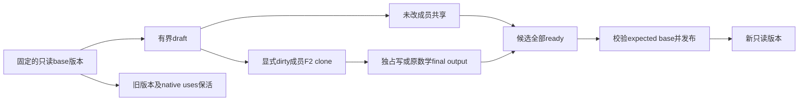

# 显式状态版本、分页计算与四路线组合设计

设计分成三个独立验收包：F4显式集合版本、F5真实paged/ragged数学、A四路线Graph语义接缝。
需要共同的功能合同，执行和资源owner保留各route原生类型。不会把CUDA Queue、MLX Runtime、
Vk command/fence塞进一个万能executor，也不会重写Mem分页、F1/F2/F3或现有数学kernel。

## 1. 要完成的用户旅程

主旅程是混合attention/recurrent推理消费：consumer提供当前显式状态集合、已计算Q/K/V与
host-known序列布局；分支只克隆将被改写的共享块，运行成熟paged/显式参考数学，取得所有
成功输出后发布一个新版本；拒绝/失败/取消不改变旧版本，旧版本及所有native uses自然退休。
状态集合可包含recurrent FP32、conv window、KV块/布局、以及consumer认为必要的不可变host
metadata。哪些状态是合法checkpoint、接受几步和RNG/token语义由consumer决定。

正交旅程：渲染资产集合的候选更新/失败保留旧集合；数值管线的分段矩阵只读共享、独占更新、
变长段消费。这里的entry/segment ID是opaque身份，没有模型层、token、sequence或材质策略。
四路线复用同一资源/版本旅程；F5 attention数学本身是已命名的数学schema，不能假扮通用Mem功能。

## 2. 当前能力、需要补齐与必须保留的差异

| 事项 | 当前事实 | 设计裁决 |
|---|---|---|
| 租约/复制/文件 | F1/F2/F3已有四自然路线、actual retirement、范围与byte/slot预算 | KEEP/BORROW，版本层只拥有集合级glue，paged层只拥有新计算端口及batch planning |
| pure initial/final状态 | 原GatedDeltaNet明确不改initial、返回materialized final；四路线已有各自native承载 | KEEP；直接分享base和接入final，不能默认先复制整份状态 |
| 版本与发布 | 单个ReadLease/Results不能代表多个输出一致发布 | SELF显式不可变集合、draft及成功发布；不做任意回滚或模型事务 |
| Graph symbolic/variants | CPU+CUDA接共同compiler；Apple/Vulkan及其hybrid固定纯DAG | 共用静态shape/coverage模型与有限exact-native variants；general只按native事实准入 |
| control/effects | Apple/Vulkan hybrid当前连纯图显式control edge也拒绝 | 补静态依赖处理；effect按真实native端口/权限和preserves_effects准入，不仅删除拒绝条件 |
| paged/ragged | TensorView单storage，SDPA没有page/indptr；当前FlashInfer仅dense exact single路径 | 新typed数学schema和显式BatchProgram/BatchInvocation；不扩万能Tensor |
| 原生规划 | FlashInfer plan有host metadata、workspace、临时分配/调度，不能capture | 单独prepare_batch；普通Invocation的无warm规划合同不变 |
| 物理/成本 | CUDA pinned crossing；Apple统一内存仍ordering；MLX managed；Vk queues/fences | 保留不同owner、reported copy/wait与capture事实，未知private bytes继续UNKNOWN |

这里的“统一”是同一旅程有可发现、可核对的合同，不保证同dtype域、零复制、同capture或同吞吐。
本轮没有证据授权迁移整个SGLang/vLLM运行时、自动placer、cache/LRU、sampling、continuous batching
或通用增量图；它们继续属于engine或独立待办。

## 3. F4：显式不可变集合版本

### 对象与权限

以下为拟议C++对象角色，不是当前已存在的API：

| 对象 | 拥有/借用及职责 |
|---|---|
| StateSchema / StateEntryId | 冷声明有限成员、opaque IDs、描述/编码/资源约束；集合完整只相对于consumer声明的schema |
| StateVersion | 有界目录、不可变成员ReadLease/readonly native owner及不可变host metadata owner；复制版本handle O(1)，不复制payload |
| StateDraft | 一次候选；分享未改成员，替换新成功输出，或显式请求某成员clone后取得独占写权限；禁止修改base |
| CloneTicket | 复用原F2计划/独立invocation和Completion，保留source/destination/目录至actual retirement；不隐藏等待 |
| StateHead | 可选、store-local的current head。publish(expected_base, ready_version)只做原schema校验和head切换，冲突明确返回；不解释接受/回退策略 |

资源成员优先用F1 ReadLease。readonly native owner只在原route有可证明借用/导入合同下接入；
不能将一个仍可被外部alias改写的MLX array/Vk buffer说成不可变。不可导出的native布局不做
opaque raw clone：声明不支持，或consumer显式用原成熟转换生成可复制dense backing并计费。
host metadata由consumer复制/拥有后以不可变owner接入；HYLE不序列化对象、不猜测RNG或ring格式。

只读分支先分享；显式clone-on-write按声明成员/完整编码块执行，没有页面fault或隐式OS CoW。
原F2输出及guard真实退休后，沿ReadLease::try_write或原owner合法交接取得writer；不能为跨chunk
继续写绕过权限。纯out-of-place算子final output可直接replace，clone不是必经步骤。

### 版本、发布和生命周期



1. schema、范围/描述、目标预算、目录与原use记录全部预检后才消费输入/接纳copy；OOM不移动源。
2. 同一个source版本可以产生多个draft；所有未改entry共享原backing，只对dirty成员分配/copy。
3. candidate内每个writer必须完成所有实际accepted writes并成功成为readonly，才能finalize。
   candidate不是多设备同时执行的事务；仅成功head发布具有集合级可见性。外部直接可见的旧
   writable allocation不允许被“事务”覆盖，底层已写错误无法伪rollback。
4. expected_base检查和head切换在短store-local monitor内完成；publication不等GPU，不做数学/IO。
   publish冲突不改变current，candidate仍由caller明确处置；不能按branch完成顺序自动选赢家。
   这是内存中的集合可见性，不表示文件已经原子发布或持久化；持久化沿原IO/consumer合同。
5. token由store身份、record generation和schema组成，旧handle保持owner防止ABA；计数溢出拒绝。
6. cancel/abandon停止未开始工作；已接纳copy/native producer及失败prefix沿原retirement保活。
   必须覆盖F3已发现的“失败撤销未启动suffix但仍持producer”反例，不留下保活环。
7. 旧version/readers或native uses仍存活就占容量，满时Unavailable/背压；不自动驱逐版本。
   close停止新draft/head发布，collect非阻塞，drain只等本store的已接纳工作，不关闭用户Context。

拟议正常用法（契约草图，不可作为当前产品示例编译）：

```cpp
auto base = head.current();
auto draft = store.begin(base);       // 分享声明集合；不复制全模型
draft.replace(state_id, ready_final_state); // 原GDN等pure输出
auto copied = draft.clone_for_write(cache_block, original_copy_route);
// 由原completion决定何时可取得独占writer；consumer执行自己的更新。
auto candidate = draft.finalize();    // 未ready或有错误则拒绝
head.publish(base.identity(), candidate);
```

### 成本与承载

V个live版本、E个成员、D个active drafts、C个copy槽、B个backing bytes均冷设硬上限。
目录O((V+D)E)，begin/校验O(E)，payload分享零copy，dirty clone O(实际dirty bytes)，
publish已验证token时O(1)短head切换；去重backing账不能把同一F1 domain按每entry重复加。
host metadata深复制、原F2控制/Task/IO及native私有分配均独立计费，不承诺总进程硬上限。

共同机制拟置于更高层内部factor compute_state（实施时才登记QUEUED），依赖compute/F1、mem、
util/error，不能让Mem反依赖Compute或state反依赖Graph。native clone factory由原四route拥有，
只复用各F2类型，不对所有Buffer/Tensor/Invocation增加版本字段，不起私有线程池/reaper。

## 4. F5：真正paged/ragged计算消费

### 逻辑端口与容量

新增独立typed PagedAttention / RaggedAttention schema；原dense SDPA的语义/布局/热合同保留。
初期准入标准F16/BF16 Q/K/V、F32 accumulation和受审GQA/head/page/layout/causal域。
MLA、压缩稀疏格式、所有KV量化、SGLang专用ReplaySSM/Sink/Item表不自动纳入第一批。

- query为显式packed rows，输出相同logical query rows；容量Qcap与实际Qactive分开。
- paged KV以一个或有限arena backing、page size、head/depth、编码/layout描述；端口含page IDs、
  KV indptr、query indptr、last-page长度及真实active counts。page ID不是请求/token identity。
- ragged KV为packed K/V和segment offsets；不因为两者都变长就共用含混的“paged Tensor”。
- metadata主机快照与device mirror有同一generation；payload、metadata及plan目录全部有owner。
  bounds、单调indptr、end/count、page arena容量、tail、dtype/encoding/overflow/GQA都在接纳前校验。
- 每一行causal相对位置、左右对齐、空序列和有效padding有明确数学语义。仅改变shape/填零
  不够：padding rows/pages不能被当真实KV，非空Q/空KV没有原生定义则明确拒绝。

第一档选host-authoritative metadata：复制/核对caller有限host快照，再由原F2上传到本slot稳定
device buffers。不接受caller任意更改mirror却仍使用旧token。device生成的页表仅在有成熟
checked native验证和同版本来源的独立档位才准入；当前没有证据就拒绝/DEFER，不隐式D2H。

### 三个时间尺度

| 时间 | API角色（拟议） | 允许成本/不变量 |
|---|---|---|
| 冷 | BatchProgram::prepare(capacity, native endpoints)；create_invocation | 固定dtype/head/layout/算法域、资源和workspace上界；kernel/artifact准备、固定slot buffers及native capability探测；不按每步选Provider |
| 每个layout版本 | BatchInvocation::prepare_batch(host_metadata, readonly inputs) | validate、copy metadata、原native plan/scheduling、明确H2D/host等待与临时分配；返回该slot+generation的PreparedBatch |
| native提交 | PreparedBatch的run/submit | 只执行该已准备批次，保留实际依赖/输出；不再读可变caller host span、搜索Provider或隐藏新的plan |

普通Graph/Compute Invocation继续自己的bind/prepare_replay/submit合同，不把必要的batch plan
塞进原“稳定热replay”。F5是明确opt-in的managed preparation。原FlashInfer scheduler仍可产生
host临时vectors/occupancy查询，必须统计，不称为零热分配；硬拒绝未知private成本的配置要如实拒绝。

PreparedBatch是不可伪造的owner token，绑定slot、generation、validated metadata与native
plan topology。layout改变、reset、失败退役后旧token失效；仅改page ID且原调度确实不依赖其
内容时可复用plan，但依然更新device indices并保活新layout，不能按尺寸或地址猜测相同。
in-flight/旧结果阻止同slot覆写；多个slot各有独立planning/capture/workspace，不共享一个
FlashInfer wrapper的mutable plan。无全局plan cache或自动无限bucket增长。

prepare_batch预检失败不消费输入。native planning/H2D已接受后失败，就保留其真实前缀和owner，
该slot不再宣称old prepared batch可用；只有原合同证明退休/可恢复才reset，否则退休slot。
capture发生在batch preparation及必要warmup之后；稳定地址、固定batch size都不足以保证capture，
必须核对split-KV/padding/launch topology及原native能力，失败不在submit静默换数学路线。

### Direct与Graph接缝

Direct先以原native BatchProgram/BatchInvocation/PreparedBatch完成整个真实paged旅程。
Graph冷IR声明相同typed端口、capacity和外部效果，不把Python object或原Wrapper塞进公共ABI。

Graph新增opt-in BatchInvocation协调器（拟议），复用原Executable/Invocation，不重写executor。
它在submit前通过一个独立版本化BatchPlanning extension准备本slot需要的native regions；
只为实际F5节点保存有界prepared token表。普通region vtable的submit仍只运行已准备内容，
原19版region合同和普通调用者无条件常态成本不变。native region invocation、metadata/workspace
地址和PreparedBatch必须是同一slot，不能外部规划A却让Graph提交B。

只读attention不需要外部effect。写入KV的原append/scatter才声明mutable effect和writer权限：
无格式变化的布局可由原F2 byte ranges承载；需要融合/repack/quantize就借已审native operation，
不能把索引拷贝误当数学转换。共享page先由F4明确clone/私有化；成功后发布新state/layout版本。

### 四路线承载裁决

| 路线 | native paged/ragged候选 | 第一阶段明确路线与限制 |
|---|---|---|
| Linux CUDA | 锁定FlashInfer原paged_kv_t及scheduler/kernels | 优先BORROW窄C++ native bridge，不携Python/Torch或SGLang私有_cached_module补丁；尚需真实编译/数学/capture资格，当前不写PASS |
| Windows CUDA | 当前FlashInfer factor仅Linux准入 | 同数学schema与显式参考档；native paged需独立有界平台准入，不能拿WSL覆盖。未通过就明确unsupported/pending |
| CPU | 原成熟Gather/Copy/SDPA/ggml路径 | 建有独立参考oracle和显式materialize档；端口/retirement完整，但成本含gather、有效mask、KV副本，不叫原生paged或同吞吐 |
| Apple | 锁定MLX standard SDPA无page表；原ggml Metal普通tensor/view路径 | 原native转换/Gather+SDPA可作为显式参考；保持GPU执行和原array owner，内存/host wait计费。更强原生paged借库入口未证明，不自研kernel凑齐 |
| Vulkan | 原ggml/IREE标准端口未证明同FlashInfer页表 | 显式原native gather/materialize参考与能力拒绝；不偷偷改为CPU。真正paged shader/library须独立准入 |

显式materialize是可用性参考档，不是隐式fallback：编译/准备前caller选定是否允许，报告gather
bytes、临时KV/mask、提交/host wait和预算；不满足内存/数学域就拒绝，不悄悄改变算法。
同容量下scatter/page append→读取→状态branch/发布→取消/关闭必须可组合，不能只提供一次read。
未有受审native承载的格标PENDING_BY_PROVIDER，不用NOT_APPLICABLE隐藏本应实现的产品范围。

## 5. A：CPU+CUDA与Apple/Vulkan的Graph消费对称性

### 共享静态语义，保留native执行

A-01提取或调用现有Graph静态shape/effect/control验证，不复制第二份DAG合法性规则。
native MLX/Vk只接本route可承载的typed fragments，constant/packing、tensor owner、endpoint和
retirement继续原有类型。共同Graph不得把MLX managed replay伪装成CPU/CUDA共享Queue capture。

A-02先对三hybrid及两native route增加有限exact-native variant artifact表。caller声明候选
signatures/容量；冷准备一次生成并资格化，每个Invocation选定一个exact signature且reset不改shape。
未覆盖binding在创建时拒绝，不能运行时JIT或round-up padding。
完整general domain仅当整个native fragment证明该域及成本时可声明；MLX有shapeless API只是
正向候选，要检查原compile缓存/JIT、分配、输出几何及native转接，并与已有ShapeContract关联。
只交exact表时明确exact-only coverage，不能对range-domain中的未覆盖形状假报支持。

A-03允许纯节点的显式control边进入同一静态拓扑/liveness与native segment边界；数据虽无依赖，
control仍要求顺序。native单region能表达则保留，跨region沿原Completion/native dependency桥；
原runtime只有host等待时报告并遵守HostWaitPolicy。不能直接忽略边或只去掉原拒绝检查。

A-04外部effect按region真实读/写资源及别名验证：支持的custom/native region必须声明
preserves_effects，提供实际端口/权限并遵守控制边；未知effects不能剪成dead node或并发执行。
不支持的effect明确拒绝，pure GDN initial/final继续用纯图。不因CUDA compiler接受某schema就
保证CUDA每个Provider都能实现它，也不因为Apple/Vulkan没有副作用图就否定纯状态分支。

### 对称的是查询与验收合同

四路线应能在冷准备前得到明确的shape coverage、effect/control能力、native/managed、
capture/command/host wait、并发slot、external output ownership与已知/未知内存事实。
优先扩已有CompileReport/ReplayReport/Provider properties的定向事实，不能设计每次submit查询
的万能capability registry。结果可以不同，但unsupported/pending/explicit materialize不能混成PASS。

外部mutable输出只在真实消费者需要且native资源权限可表达时单独接入；保留原native owned
result作为自然默认，不能为了C++签名相同引入shadow tensor/额外CPU copy。

## 6. 接口组合

版本集合、分页算子和 Graph 控制/效果边界分别拥有自己的合同。
实现时用真实消费者验证端口、资源权限、版本提交和异步依赖；共享元数据 ABI 和寿命规则，
不把不支持的 native 路径强行转换成同一执行器。

## 7. 验收设计

F4：共享root只计一次、两个draft不同dirty集合、pure输出不复制base、旧reader阻止write/reuse、
OOM/错schema/ABA/overflow/发布冲突、已接纳copy失败和取消、native未知、最后guard晚到、
未启动suffix、跨线程drop、关闭不关用户runtime。模型consumer自行验证完整checkpoint与接受范围。

F5：物理页顺序随机重排且结果不变；非整尾页/非uniform query长度/GQA/因果位置；相同shape
不同page IDs/layout generation不能误复用；错indptr/坏page/tail/溢出拒绝不接受工作；empty域
有明确原数学定义或拒绝；metadata/payload同时持用、生产者未完成、partial upload/error/cancel/
old output。独立dense oracle只作数学参考，成本比较含所有gather/plan/copy/mask/host waits。
capture更换topology应拒绝/重准备，未资格路径不宣称captured；普通submit不偷偷plan/JIT。

A：exact/general coverage真实区分、未覆盖shape拒绝；控制边虽无数据依赖也有顺序；conflicting
effects、readonly/mutable alias、old result与native桥接；每route自己的native/cost事实单列。

按实际修改检查相关消费者和安装边界。真机计算、构建安装和软件模拟结果分别说明；
选择并行度时考虑实际资源，复用身份匹配的缓存。缺少 native 实现或未运行不能写成通过。
